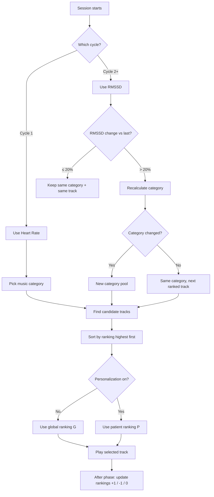

# Skitii Music System — Plain-Language Guide

This document explains **how Skitii chooses and ranks music** during a live session. It is written for non-technical readers: clinicians, product managers, support staff, and anyone who wants to understand *why* a certain track plays — without reading code.

**Author:** Swapnil Sagvekar

---

## 1. What Skitii Is Trying to Do

Most music apps play a fixed playlist. Skitii is different.

Skitii listens to the patient’s body signals during a session — mainly **heart rate (HR)** and **heart rate variability (RMSSD)** — and uses that information to:

1. **Pick the right type of music** (calming, grounding, etc.)
2. **Pick the best track** within that type
3. **Learn over time** which tracks actually help that patient

The goal is simple: **play music that supports the patient’s current physiological state**, and **get better at it with every session**.

---

## 2. Key Ideas (Simple Definitions)

| Term | Plain meaning |
|------|----------------|
| **Heart Rate (HR)** | How fast the heart is beating (beats per minute). Higher often means more stress or activation. |
| **RMSSD** | A measure of heart rate variability (shown as **HRV** in the Admin panel). Higher RMSSD often means the body is more relaxed and recovering. |
| **Phase** | One measurement window in a session (e.g. a few minutes of monitoring). |
| **HRM Cycle** | One full heart-rate monitoring cycle within a session. Cycle 1 uses HR; later cycles use RMSSD. |
| **Category (Music Tier)** | A group of music with a similar emotional/physiological purpose: Grounding, Calming, Restorative, or Uplifting. |
| **Track** | One individual music file (one song). |
| **Ranking** | A score attached to each track. Higher score = “this track is more likely to be chosen first.” |
| **Personalization** | When the system has learned enough about a specific patient to use *their* rankings instead of global ones. |

---

## 3. The Four Music Categories

Skitii organizes all music into **four tiers**. Think of them as four “moods” or “support levels”:

```
Most stressed / lowest recovery          Most relaxed / highest recovery
        ↓                                              ↓
   Grounding  →  Calming  →  Restorative  →  Uplifting
```

### What each category means

| Category | When it is typically used | Patient state (simplified) |
|----------|---------------------------|----------------------------|
| **Grounding** | High stress, very low recovery | Heart racing, body not settling |
| **Calming** | Elevated stress, needs settling | Activated but not extreme |
| **Restorative** | Moderate recovery | Body starting to balance |
| **Uplifting** | Good recovery, relaxed state | Calm, open, positive energy |

### Category conditions (configured in Admin)

Each category is defined in **Music Therapy → Categories** with three ranges. These are the active conditions in Skitii Admin:

| Category | HR (bpm) | HRV / RMSSD (ms) | Music BPM |
|----------|----------|------------------|-----------|
| **Grounding** | 95 – 300 | 0 – 20 | 50 – 60 |
| **Calming** | 85 – 94 | 21 – 35 | 61 – 70 |
| **Restorative** | 70 – 84 | 36 – 55 | 71 – 80 |
| **Uplifting** | 0 – 69 | 56 – 100 | 81 – 90 |

**How to read this table:**
- **HR (bpm)** — heart rate range that points to this category during the **first session cycle**.
- **HRV / RMSSD (ms)** — heart rate variability range that points to this category from **cycle 2 onward**.
- **Music BPM** — the tempo band for tracks in that category (beats per minute).

> **Note:** In the live session app, HRV is measured as **RMSSD**. The Admin panel label is **HRV**; both refer to the same signal used for category matching.

Each track in the library belongs to one of these categories. Individual tracks can also have **trigger ranges** — specific HR or RMSSD values where that track is especially suitable.

---

## 4. How the Category Is Chosen During a Session

Music selection happens in **two stages** across the session.

### Stage A — First cycle: based on Heart Rate (HR)

At the **start of the session** (HRM Cycle 1), Skitii looks at the patient’s **average heart rate** and maps it to a category using the **HR** ranges from Admin:

| Average HR | Category chosen |
|------------|-----------------|
| 95 – 300 | Grounding |
| 85 – 94 | Calming |
| 70 – 84 | Restorative |
| 0 – 69 | Uplifting |

**Example:** If baseline HR is 65 → **Uplifting** music is chosen for the opening.

This gives a sensible starting point based on how activated the patient’s body is.

---

### Stage B — Later cycles: based on RMSSD (adaptive)

From **Cycle 2 onward**, Skitii switches to **RMSSD (HRV)** because it better reflects recovery and nervous system balance, using the **HRV / RMSSD** ranges from Admin:

| RMSSD (HRV) value | Category chosen |
|-------------------|-----------------|
| 0 – 20 | Grounding |
| 21 – 35 | Calming |
| 36 – 55 | Restorative |
| 56 – 100 | Uplifting |

**Example:** If RMSSD is 35.94 → **Restorative** music.

---

### The “20% change rule” — when to change music

After the first RMSSD reading, Skitii compares each new RMSSD value to the **previous one** and asks:

> “Did the body change meaningfully since last time?”

| RMSSD change | What happens |
|--------------|--------------|
| **20% or less** | Keep the **same category** and keep the **same track**. The body is relatively stable — no need to disrupt the music. |
| **More than 20%** | Re-evaluate. The body shifted enough that music may need to adapt. |

**Why 20%?**  
Small natural fluctuations happen all the time. The 20% threshold prevents the music from jumping around on tiny changes. Only meaningful shifts trigger a change.

**Example from a real session pattern:**
- Phase 2: RMSSD drops 8.88% → **same track** (under 20%)
- Phase 4: RMSSD jumps 47.33% → **significant change** → music may progress to next ranked track
- Phase 6: RMSSD changes only 2.61% → **same track** again

---

### What happens when change is over 20%

Two things can occur:

1. **Category changes** → Skitii moves to a new pool of tracks in the new category (e.g. from Calming to Restorative).

2. **Category stays the same** → Skitii stays in the same category but may **pick a different track** — moving down a ranked list of best tracks for that tier.

---

## 5. How a Specific Track Is Chosen (Ranking Logic)

Once the category (or trigger match) defines a **pool of candidate tracks**, Skitii picks one track using **ranking**.

### Step 1 — Build the candidate pool

Skitii looks for tracks in this order:

1. **Trigger match** — tracks whose HR or RMSSD range exactly fits the current reading (most precise match).
2. **Category match** — all tracks in the chosen tier (Grounding, Calming, etc.).
3. **Fallback** — if nothing matches, use Calming or any available track.

When RMSSD change is **small (≤ 20%)**, Skitii **only** looks within the current category — it will not pull a track from another category even if a trigger would match.

---

### Step 2 — Sort tracks by ranking (highest first)

Every track has a **ranking score**. Higher score = played sooner.

Tracks are sorted from **best to worst**. The system then picks based on session progression:

| Situation | Which track plays |
|-----------|-------------------|
| **First cycle (HR phase)** | Top-ranked track in the pool (position 1) |
| **RMSSD change ≤ 20%** | **Same track as before** — no change |
| **RMSSD change > 20%** | Move to the **next position** in the ranked list (position 1, then 2, then 3…) |

**Example:**  
If Restorative has 3 tracks ranked A (score 20), B (score 8), C (score 6):
- First significant RMSSD event → Track A
- Next significant event (same category) → Track B
- Next → Track C

This creates a **gentle progression** through proven tracks rather than random switching.

---

## 6. Two Types of Ranking: Global vs Personalized

Skitii maintains **two layers of learning**.

### Global ranking (for everyone)

- Every track starts with a base score (default: 0).
- After each session phase (from Phase 2 onward), Skitii records how the patient’s RMSSD changed while that track was playing.
- The ranking moves up or down:

| RMSSD direction after the phase | Ranking change |
|--------------------------------|----------------|
| Improved (positive change) | **+1** |
| Worsened (negative change) | **−1** |
| No meaningful direction | **0** |

**Important:** The system cares about **direction** (better or worse), not the exact percentage. A 5% improvement and a 50% improvement both add +1.

Over time, tracks that consistently help patients rise to the top. Tracks that don’t help sink lower.

This is **crowd wisdom** — the library learns from all patients.

---

### Personalized ranking (for one patient)

The same +1 / −1 / 0 logic also runs **per patient, per track**.

But personalization only **takes over** when the patient has enough history:

> **Personalization is enabled when the patient has personalized data for at least 5 different tracks in every active music category.**

Until then, Skitii uses **global rankings**.

Once enabled:
- Only tracks with personalized records are used.
- Rankings reflect **what works for this specific patient**, not the average user.
- The screen shows **“P”** (personalized) instead of **“G”** (global).

---

## 7. What the User Sees on Screen (Indicators)

During live monitoring, small badges help staff understand the music logic:

| Badge | Meaning |
|-------|---------|
| **G** | Using global (population-wide) ranking |
| **P** | Using personalized ranking for this patient |
| **R1, R2, R3…** | Track position in the global ranked list (R1 = best) |
| **PR1, PR2…** | Track position in the personalized ranked list |
| **12%** (example) | How much RMSSD changed between phases |
| **SAME** | Change was ≤ 20% → same track will continue |
| **NEXT** | Change was > 20% → system will move to next ranked track |

Green/red coloring on the percentage shows whether the change crossed the 20% threshold.

---

## 8. End-to-End Session Flow (Story Example)

Imagine a patient starting a session with HR = 65:

**Cycle 1 — HR phase**
- Category: **Uplifting** (HR below 70)
- Pool: all Uplifting tracks
- Track: highest-ranked Uplifting track (R1)

**Cycle 2 — First RMSSD = 35.94**
- Category: **Restorative** (RMSSD in the 36–55 band)
- First RMSSD cycle → pick top Restorative track
- Significant change gate: first cycle always applies ranking

**Cycle 3 — RMSSD = 32.75 (drops ~8.9%)**
- Change < 20% → **same Restorative track**
- Category unchanged

**Cycle 4 — RMSSD = 48.56 (jumps ~47%)**
- Change > 20% → **next ranked Restorative track**
- Still Restorative category

**After session — learning**
- For each phase from Phase 2 onward, the system saves:
  - Which track played
  - Whether RMSSD improved or worsened
- Global ranking updates for that track
- Patient’s personal ranking updates too

**After many sessions**
- Patient has 5+ personalized tracks in each category
- Personalization turns on
- Future sessions use **their** rankings (PR1, PR2…) instead of global ones (R1, R2…)

---

## 9. Why This Approach Makes Skitii Stronger Than Typical Products

Here is how Skitii compares to common alternatives:

| Approach | Limitation | How Skitii is different |
|----------|------------|-------------------------|
| **Fixed playlist apps** (Spotify, Calm, etc.) | Same music for everyone, no body feedback | Skitii reacts to live HR and RMSSD |
| **Manual clinician choice** | Depends on judgment each time; hard to scale | Skitii uses consistent, repeatable rules |
| **Simple “if HR high → play slow music”** | One rule, no memory, no learning | Skitii has tiers, triggers, 20% stability gate, and ranked progression |
| **Biofeedback without learning** | Adapts in the moment but forgets next session | Skitii **remembers** which tracks helped (+1/−1 over time) |
| **Personalization without enough data** | Can overfit too early | Skitii waits until **5 tracks per category** before switching to personal mode |
| **Frequent track switching** | Can feel jarring and break focus | The **20% rule** keeps music stable when the body is stable |

### Product quality strengths in one sentence each

1. **Physiologically grounded** — Music type matches what the body is actually doing, not just a generic “relaxation” label.

2. **Stable when it should be** — Small body fluctuations do not cause unnecessary music changes.

3. **Responsive when it matters** — Large shifts (>20%) trigger meaningful adaptation.

4. **Gets smarter over time** — Every session teaches the system which tracks work.

5. **Personal when ready** — Early sessions use proven global data; later sessions become tailored to the individual.

6. **Transparent for clinicians** — On-screen badges (G/P, R1, NEXT/SAME, %) show *why* a track was chosen, building trust.

7. **Structured music library** — Four clear tiers plus per-track trigger ranges give precision without chaos.

---

## 10. Simple Diagram — Decision Flow



---

## 11. Frequently Asked Questions (Non-Technical)

**Q: Why doesn’t Skitii change music every time RMSSD moves a little?**  
A: Because small changes are normal. The 20% rule avoids restless switching and lets the patient settle into the music.

**Q: What if a patient is new?**  
A: Global rankings from all users guide track selection until the patient has enough session history.

**Q: Can a Calming track play when Restorative was chosen?**  
A: Only in specific cases — when RMSSD change is large (>20%) and a track’s **trigger range** exactly matches the current reading. During stable periods, Skitii stays within the chosen category.

**Q: Does a bigger RMSSD improvement give more ranking points?**  
A: No. Only the **direction** matters: better = +1, worse = −1. This keeps the system simple and fair across different patients.

**Q: What happens if ranking is tied?**  
A: Tracks are ordered consistently (by a stable internal ID) so the same input always gives the same order.

**Q: Is the music choice random?**  
A: No. It follows clear rules: body signal → category → ranked list position → learning from outcomes.

---

## 12. Summary

| Layer | What it does |
|-------|--------------|
| **Categories** | Match music type to body state (Grounding → Uplifting) |
| **Triggers** | Fine-tune track choice to specific HR/RMSSD ranges |
| **20% gate** | Prevent unnecessary music changes |
| **Ranking** | Order tracks from most to least effective |
| **Global learning** | Improve the library for all patients |
| **Personal learning** | Tailor rankings to one patient after enough data |
| **Progression** | Move through ranked tracks when the body shifts significantly |

Skitii is not just “play relaxing music.” It is a **closed-loop system**: the body informs the music, the music is evaluated by how the body responds, and future sessions benefit from that feedback.

---

