# Skitii Product Admin — RBAC Panel Design
**Audience:** Leadership / product / engineering  
**App:** Skitii Admin Frontend (Product Admin)  
**APIs:** Skitii Backend (OTP · users · roles · modules · actions · me)  
**Date:** September 2026  
**Author:** Swapnil Sagvekar  
**Status:** Design target — dynamic modules & actions (Super Admin managed)  
**Related:** Unified nav doc · 10-day RBAC task list · 4-day audit task list

---

## 1. Purpose

This document is the **admin panel design** for User Management and **dynamic RBAC** in Product Admin.

Super Admin (and users with the right administration modules) can:

1. **Manage users** — internal and institution accounts; assign roles; block/unblock  
2. **Manage roles** — create roles with **Empty / Clone / Preset**, then tick a **permission matrix**  
3. **Manage modules** — create/edit sidebar + API module keys (dynamic catalog)  
4. **Manage actions** — define actions **per module** (not fixed to view/create/edit/delete only)  
5. **Inspect audit** — append-only history (separate sprint; shell in IA)

**Core rule:** Permissions are **`moduleKey` + `actionKey`**, both stored in MongoDB. Adding “view weekly form” does **not** require a code deploy for the catalog — Super Admin adds the action, then assigns it on a role. Developers still wire `@RequirePermission` when a new API/UI feature ships.

---

## 2. Executive summary

| Topic | Decision |
|-------|----------|
| **Where** | Product Admin only (`Skitii-Admin-Frontend`) — Administration section |
| **Who configures** | Super Admin (full); optional User Admin with `product.modules` / `product.actions` / `product.roles` |
| **Modules** | **Dynamic** — `adminNavModules` CRUD in UI |
| **Actions** | **Dynamic per module** — `adminModuleActions` CRUD in UI |
| **Roles** | Custom + system; matrix columns = active actions for each module; **create with Empty / Clone / Preset** |
| **Users** | `roleIds[]`; effective permissions = **union** (OR) of roles |
| **Sidebar** | Show module if any granted action has `controlsSidebar: true` (usually `view`) |
| **Common sidebar** | **One shared sidebar** (same catalog + filter) in Product Admin and Trial Admin; **URLs stay different** (two apps / two hosts) |
| **JWT** | Small (`sub`, email, status); load `me.permissions` per session |
| **Trial Admin** | Reads same `me` / nav; does **not** host Users/Roles/Modules screens |

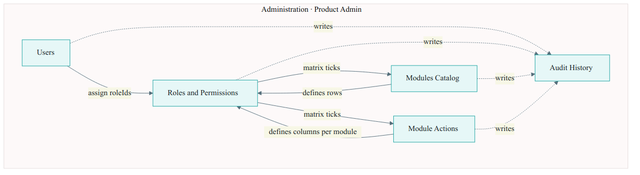

---

## 3. Information architecture

```
Product Admin sidebar
────────────────
… Product & Trial sections (permission-filtered) …
────────────────
Administration
  · Users
  · Roles & Permissions
  · Modules
  · Module Actions
  · Audit History
```

| Screen | Route (proposed) | Module key | Purpose |
|--------|------------------|------------|---------|
| **Users** | `/users` | `product.users` | List / create / edit / assign roles / block |
| **Roles & Permissions** | `/roles` | `product.roles` | Role CRUD + dynamic matrix |
| **Modules** | `/modules` | `product.modules` | Catalog CRUD for nav + ACL keys |
| **Module Actions** | `/module-actions` | `product.actions` | Actions per module |
| **Audit History** | `/audit` | `product.audit` | Read-only trail (audit sprint) |

### 3.1 Common sidebar — one IA, two URLs

**Decision:** Both admin frontends use **one common sidebar**. They do **not** become a single SPA. Each app keeps its **own host / URL**.

| Topic | Choice |
|-------|--------|
| **Apps** | Keep **Skitii-Admin-Frontend** (Product Admin) and **Skitii-Trial-Admin-Frontend** (Trial Admin) separate |
| **Sidebar** | **Same** sections, labels, module keys, and permission filter in both apps |
| **Catalog** | One MongoDB catalog (`adminNavModules` + actions); both call `me` + `myNavigation` |
| **URLs** | Different bases — e.g. `product.admin.skitii.com` vs `trial.admin.skitii.com` |
| **Same-panel link** | In-app path only (e.g. Trial item while on Trial → `/patients`) |
| **Other-panel link** | Other app `baseUrl` + path with **↗** (e.g. Product item while on Trial → `PRODUCT_ADMIN_URL/institutions`) |
| **Shared code** | Prefer one shared sidebar package / copy-aligned contract (item shape: `key`, `title`, `path`, `icon`, `section`, `panel`) — extract via Product Frontend / shared module if that is the chosen home |
| **Env** | `PRODUCT_ADMIN_URL` · `TRIAL_ADMIN_URL` resolve external hrefs (not stored in DB) |

```
┌─ Product Admin (product.admin…) ─┐     ┌─ Trial Admin (trial.admin…) ─┐
│  Sidebar (same catalog)          │     │  Sidebar (same catalog)       │
│  · Product items → in-app        │     │  · Trial items → in-app       │
│  · Trial items → ↗ Trial URL     │     │  · Product items → ↗ Product  │
│  · Administration → in-app       │     │  · Administration → ↗ Product │
└──────────────────────────────────┘     └───────────────────────────────┘
         ▲                                          ▲
         └──── adminNavModules + me.permissions ────┘
```

**Rules**

- Show an item only if the user has a granted action with `controlsSidebar: true` (normally `view`)
- Hide empty sections (Product / Trial / Administration)
- Deep link to a hidden module → dashboard + toast; API still enforces `@RequirePermission`
- Users / Roles / Modules / Module Actions / Audit screens exist **only** on Product Admin; Trial sidebar links to them with **↗**

**Not in scope of “common sidebar”:** merging Product Admin and Trial Admin into one deployable URL.

---

## 4. Dynamic RBAC model

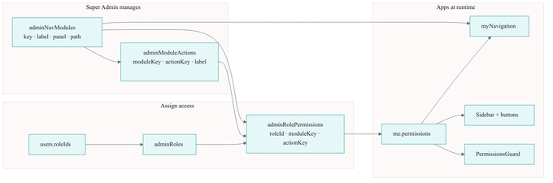

| Layer | Collection | Super Admin can |
|-------|------------|-----------------|
| Module catalog | `adminNavModules` | Create / edit / activate / deactivate |
| Actions | `adminModuleActions` | Add `view_weekly_form`, `export`, … per module |
| Roles | `adminRoles` | Create custom roles |
| Grants | `adminRolePermissions` | Tick `(role, moduleKey, actionKey)` |
| Users | `users.roleIds` | Assign one or more roles |

### 4.1 Example — view weekly form

| Step | Result |
|------|--------|
| Module | `trial.patients` (or dedicated `trial.weekly_forms`) |
| Action | `view_weekly_form` · label “View weekly form” · `controlsSidebar: false` |
| Role **Patient Viewer** | `view` = true; `view_weekly_form` = false |
| Role **Patient Manager** | `view` + `create` + `edit` + `view_weekly_form` + `edit_weekly_form` |
| UI | Patient Manager sees Weekly form button; Viewer does not |
| API | `@RequirePermission('trial.patients', 'view_weekly_form')` |

### 4.2 Super Admin setup flow

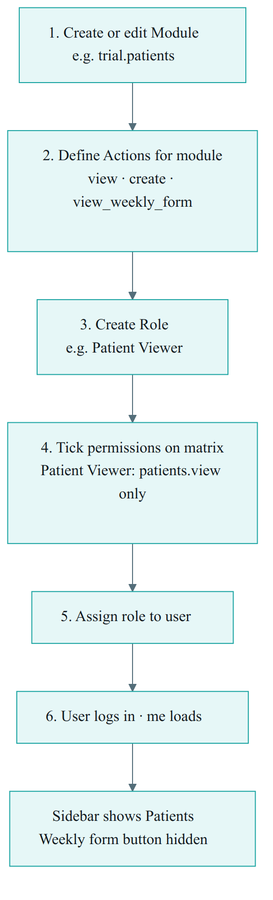

```
1. Modules → create / edit module key
2. Module Actions → define actions for that module
3. Roles → create role → tick matrix (columns = those actions)
4. Users → assign roleId(s)
5. Login → me.permissions + myNavigation update automatically
```

---

## 5. Shell & design language

| Element | Choice |
|---------|--------|
| Layout | Same Product Admin shell — left sidebar, top bar, theme toggle |
| Brand | Teal primary `#1BA4A2`, deep blue accents |
| Tables | Search + filters + pagination; row actions Edit |
| Dialogs | Create / edit forms; confirm for deactivate / block |
| Matrix | Per-module action chips (checkbox pills), not a rigid 4-column grid |
| Empty | “No actions for this module — add in Module Actions” |
| Forbidden | Hide nav without `view` (or `controlsSidebar`); toast + redirect on deep link |

---

## 6. Users

**Route:** `/users`  
**Permission:** `product.users` + action (`view` / `create` / `edit`)

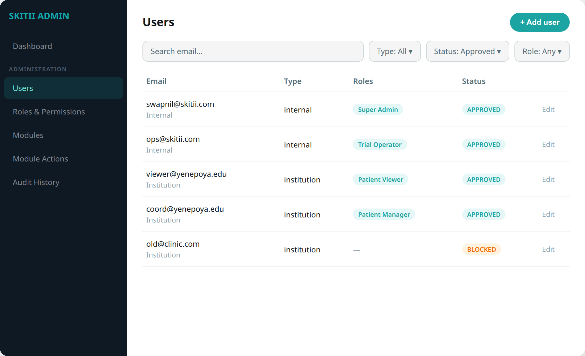

### 6.1 List

| Control | Behavior |
|---------|----------|
| Search | Email (case-insensitive) |
| Filters | User type · Status · Role |
| Columns | Email · Type · Roles · Status · actions |
| Add user | Email + userType + initial roleIds (OTP on first login) |

### 6.2 Edit / assign roles

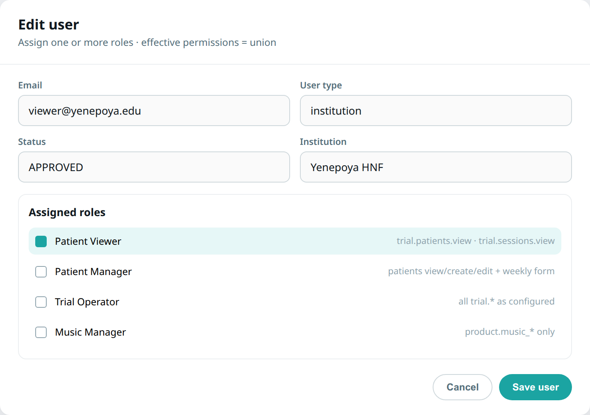

| Field | Notes |
|-------|-------|
| Email | Unique; lowercase |
| User type | `internal` · `institution` · `clinical` |
| Status | APPROVED / BLOCKED (with reason) |
| Institution | Read-only link when `institution` |
| **Roles** | Multi-select `roleIds`; union of matrices |

**Rules**

- Only Super Admin can create/edit/block Super Admins  
- Last Super Admin cannot be blocked  
- Institution data scope still from `institutions.userId` — roles only control **which modules/actions**

---

## 7. Roles & Permissions

**Route:** `/roles`  
**Permission:** `product.roles`

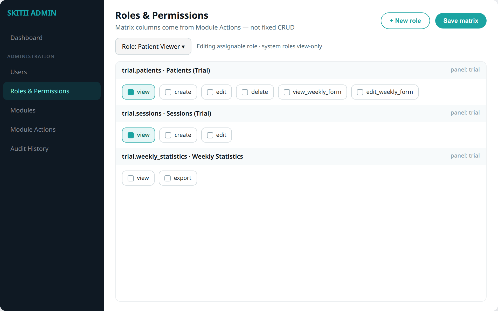

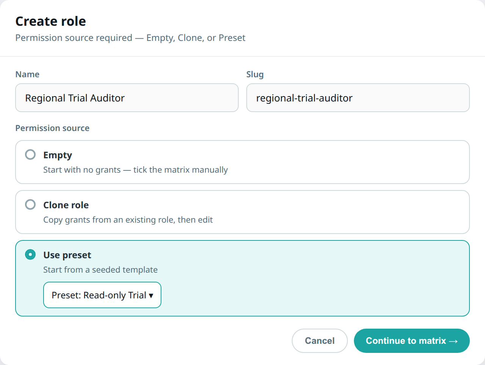

### 7.1 Role list

| Kind | Editable matrix? |
|------|------------------|
| System (`super-admin`, …) | View-only (or Super-Admin-only) |
| Custom | Full edit · archive if unused |

### 7.2 Create role — permission source (**required**)

Creating a role **must** support assigning permissions in the same flow. Super Admin chooses a **permission source**, then reviews/edits the matrix before save.

| Option | Behavior |
|--------|----------|
| **Empty** | Blank matrix — tick actions manually |
| **Clone role** | Pick any existing role → copy all `adminRolePermissions` → edit before save |
| **Preset** | Pick a named template → same grants as that preset → edit before save |

**Create-role wizard**

```
1. Name · slug · description
2. Permission source: Empty | Clone from role… | Use preset…
3. Review / edit dynamic matrix
4. Save → create adminRoles + write adminRolePermissions in one transaction
```

**Rules**

- Clone / preset only copies **grants**; new role gets its own `_id` and slug  
- System roles (e.g. Super Admin) may be clone **sources** but remain non-editable as targets  
- After save, matrix editor stays available for later tweaks  
- List UI also offers **Clone** on a row (opens wizard with that role pre-selected as source)

### 7.3 Required presets (seed)

| Preset id / slug | Label | Typical grants |
|------------------|-------|----------------|
| `preset-readonly-trial` | Read-only Trial | All active `trial.*` **view** (sidebar) only |
| `preset-patient-viewer` | Patient Viewer | `trial.patients.view`, `trial.sessions.view` |
| `preset-patient-manager` | Patient Manager | patients view/create/edit + `view_weekly_form` / `edit_weekly_form` |
| `preset-trial-operator` | Trial Operator | Full configured `trial.*` matrix |
| `preset-music-manager` | Music Manager | `product.music_categories` + `product.music_library` CRUD |
| `preset-content-manager` | Content Manager | `product.blog_*` + `product.podcast_*` + `product.episodes` CRUD |
| `preset-full-product-admin` | Full Product Admin | All active `product.*` (except Super-Admin-only ops) |

Presets can be implemented as **system roles marked `isPreset: true`** (selectable in the wizard but not assigned to users directly) **or** as dedicated seed templates that expand to grant rows. Either way, they ship with Day-1 seed and appear in the create-role UI.

### 7.4 Matrix UI

- Select a role  
- For **each active module**, show **its** actions as checkbox pills  
- Columns differ by module (e.g. Patients has `view_weekly_form`; Statistics has `export`)  
- Save writes `adminRolePermissions` rows (`granted: true/false` or upsert granted only)

### 7.5 `me.permissions` shape

```json
{
  "trial.patients": {
    "view": true,
    "create": false,
    "edit": false,
    "delete": false,
    "view_weekly_form": false,
    "edit_weekly_form": false
  },
  "trial.weekly_statistics": {
    "view": true,
    "export": false
  }
}
```

Helpers: `can('trial.patients', 'view_weekly_form')`.

---

## 8. Modules Catalog

**Route:** `/modules`  
**Permission:** `product.modules`  
**Who:** Super Admin (recommended); optional delegated admin

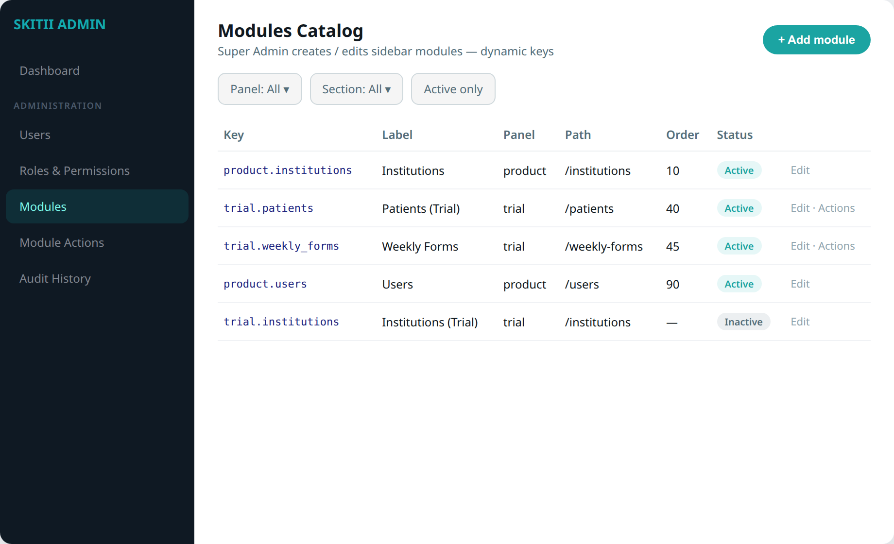

### 8.1 Fields

| Field | Required | Description |
|-------|----------|-------------|
| `key` | yes | Stable id, e.g. `trial.patients` (immutable after create if in use) |
| `label` | yes | Sidebar label |
| `panel` | yes | `product` \| `trial` |
| `path` | yes | In-app path |
| `section` | no | Product / Trial / Administration |
| `sortOrder` | yes | Order within section |
| `icon` | no | Lucide name |
| `isActive` | yes | Inactive = hidden from nav & new grants |

### 8.2 Behaviors

- **Add module** — opens form; after save, prompt to add default actions (`view`, `create`, `edit`, `delete`)  
- **Edit** — label, path, section, order, active  
- **Deactivate** — soft hide; existing role grants retained but nav hides  
- **Actions** link — jump to Module Actions filtered by this key  

**Not in DB:** environment `baseUrl` — resolved from `PRODUCT_ADMIN_URL` / `TRIAL_ADMIN_URL` at runtime.

**Caveat:** Creating a module in UI does **not** invent screens or GraphQL resolvers. Dev must ship the page + `@RequirePermission(moduleKey, actionKey)`.

---

## 9. Module Actions

**Route:** `/module-actions`  
**Permission:** `product.actions`

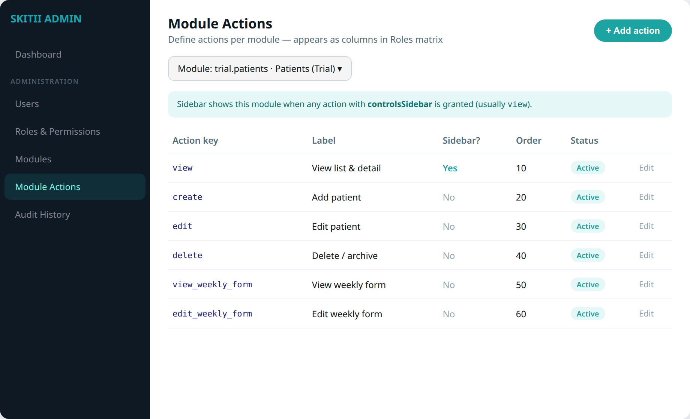

### 9.1 Fields

| Field | Required | Description |
|-------|----------|-------------|
| `moduleKey` | yes | FK → `adminNavModules.key` |
| `actionKey` | yes | e.g. `view`, `view_weekly_form`, `export` |
| `label` | yes | Human label in Roles UI |
| `controlsSidebar` | yes | If true and granted → show module in sidebar |
| `sortOrder` | yes | Order in matrix row |
| `isActive` | yes | Inactive = hidden from new matrix edits |

### 9.2 Defaults on new module

Seed or one-click: `view` (sidebar), `create`, `edit`, `delete`.

### 9.3 Custom examples

| moduleKey | actionKey | Label | Sidebar? |
|-----------|-----------|-------|----------|
| `trial.patients` | `view_weekly_form` | View weekly form | No |
| `trial.patients` | `edit_weekly_form` | Edit weekly form | No |
| `trial.weekly_statistics` | `export` | Export CSV | No |
| `product.institutions` | `approve` | Approve institution | No |

---

## 10. Database design

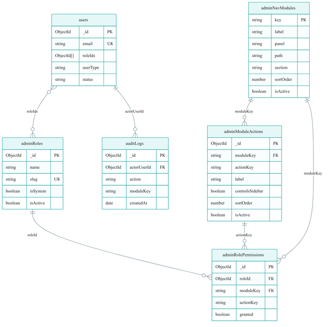

### 10.1 Collections

| Collection | Change |
|------------|--------|
| `users` | Add `roleIds[]`, `userType` |
| `adminRoles` | New |
| `adminNavModules` | New — Super Admin CRUD |
| `adminModuleActions` | **New** — dynamic actions |
| `adminRolePermissions` | New — `(roleId, moduleKey, actionKey, granted)` |
| `auditLogs` | New (audit sprint) |

### 10.2 `adminModuleActions` (example)

```json
{
  "moduleKey": "trial.patients",
  "actionKey": "view_weekly_form",
  "label": "View weekly form",
  "controlsSidebar": false,
  "sortOrder": 50,
  "isActive": true
}
```

### 10.3 `adminRolePermissions` (example)

```json
{
  "roleId": "<PatientViewerId>",
  "moduleKey": "trial.patients",
  "actionKey": "view",
  "granted": true
}
```

**Indexes**

```javascript
db.adminModuleActions.createIndex(
  { moduleKey: 1, actionKey: 1 },
  { unique: true }
)
db.adminRolePermissions.createIndex(
  { roleId: 1, moduleKey: 1, actionKey: 1 },
  { unique: true }
)
db.adminNavModules.createIndex({ key: 1 }, { unique: true })
db.users.createIndex({ roleIds: 1 })
```

### 10.4 Permission resolution

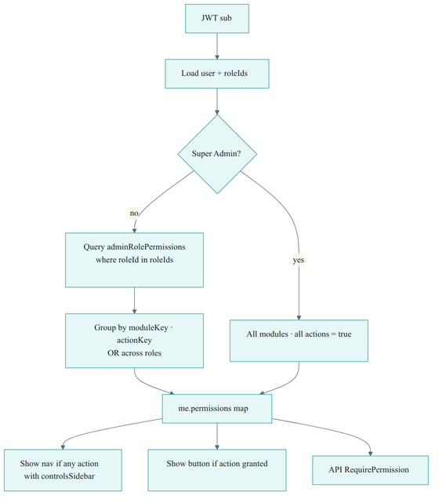

```
1. Load user.roleIds
2. Super Admin → all active modules × all active actions = true
3. Else load adminRolePermissions for those roles where granted
4. Merge OR by (moduleKey, actionKey)
5. Sidebar: modules where any granted action has controlsSidebar
6. Buttons / guards: can(moduleKey, actionKey)
```

---

## 11. APIs (Product Backend)

| API | Consumer |
|-----|----------|
| `me` | Both admin apps — `{ permissions, roleIds, userType, … }` |
| `myNavigation(panel)` | Sidebar items from catalog + sidebar actions |
| Users CRUD | Product Admin |
| Roles CRUD + setPermissions | Product Admin |
| Modules CRUD | Product Admin (Super Admin) |
| Module Actions CRUD | Product Admin (Super Admin) |
| `PermissionsGuard(moduleKey, actionKey)` | Every admin resolver |

**Guard example**

```ts
@RequirePermission('trial.patients', 'view_weekly_form')
```

---

## 12. Screen-level UX rules

| Situation | UI behavior |
|-----------|-------------|
| No `view` (sidebar action) | Hide nav item; deep link → dashboard + toast |
| Has `view`, no `create` | Hide Add button |
| Has `view`, no `edit_weekly_form` | Hide or disable Weekly form edit |
| API called without grant | `FORBIDDEN` with module + action in error |
| Module has zero actions | Roles panel shows empty state + link to Module Actions |
| Deactivated module | Hidden from nav; matrix may show read-only historical grants |

---

## 13. Seed checklist (v1)

| Item | Notes |
|------|-------|
| Modules | All current Product + slim Trial keys + Administration keys (see §13.1) |
| Default actions | `view`/`create`/`edit`/`delete` on CRUD modules |
| Custom seed | `trial.patients` → `view_weekly_form`, `edit_weekly_form` |
| Roles | Super Admin · Full Product Admin · Trial Operator · Patient Viewer · Patient Manager · Music Manager · Content Manager |
| **Presets** | Read-only Trial · Patient Viewer · Patient Manager · Trial Operator · Music Manager · Content Manager · Full Product Admin (`isPreset` or template seed) |
| Users | Migrate existing `ADMIN` → Full Product Admin or Super Admin |

Inactive: `trial.institutions`, `trial.music` (handled in Product).

### 13.1 Product Admin module keys (seed)

Matches current Product Admin sidebar (`menuConfig`), including Blogs and Podcasts CMS.

| Key | Sidebar label | Route | Default actions |
|-----|---------------|-------|-----------------|
| `product.dashboard` | Dashboard | `/dashboard` | `view` |
| `product.institutions` | Institutions | `/institutions` | `view` `create` `edit` `delete` (+ `approve`) |
| `product.devices` | Physical Devices | `/devices` | `view` `create` `edit` `delete` |
| `product.patients` | Patients | `/patients` | `view` `create` `edit` `delete` |
| `product.sessions` | Sessions | `/sessions` | `view` |
| `product.music_categories` | Music Categories | `/category` | `view` `create` `edit` `delete` |
| `product.music_library` | Music Library | `/music` | `view` `create` `edit` `delete` |
| `product.email_categories` | Email Categories | `/email-templates/categories` | `view` `create` `edit` `delete` |
| `product.email_templates` | Email Templates | `/email-templates` | `view` `create` `edit` `delete` |
| `product.inquiries` | Inquiries | `/inquiries` | `view` `edit` |
| `product.blog_topics` | Blog Topic | `/blogs/categories` | `view` `create` `edit` `delete` |
| `product.blogs` | Blogs | `/blogs` | `view` `create` `edit` `delete` |
| `product.podcast_topics` | Podcast Topic | `/podcasts/categories` | `view` `create` `edit` `delete` |
| `product.podcasts` | Podcasts | `/podcasts` | `view` `create` `edit` `delete` |
| `product.episodes` | Episodes | `/episodes` | `view` `create` `edit` `delete` |
| `product.users` | Users | `/users` | `view` `create` `edit` |
| `product.roles` | Roles & Permissions | `/roles` | `view` `create` `edit` |
| `product.modules` | Modules | `/modules` | `view` `create` `edit` |
| `product.actions` | Module Actions | `/module-actions` | `view` `create` `edit` |
| `product.audit` | Audit History | `/audit` | `view` |

**Backend gate (Blogs / Podcasts):** admin resolvers under `src/blog` and `src/podcast` — currently `@Roles(ADMIN)`; RBAC sprint maps them to the keys above via `@RequirePermission`.

---

## 14. Out of scope / later

| Item | Notes |
|------|-------|
| Trial Admin hosting Users/Modules UI | Product Admin only |
| Instant new screens without code | Catalog is config; pages still need FE + BE |
| Audit writer/UI polish | 4-day audit sprint |

---

## 15. Relation to other docs

| Doc | Role |
|-----|------|
| **This design** | Screens, dynamic modules/actions, wireframes, DB for Admin RBAC panel |
| Unified nav & user management | Cross-app sidebar + auth + Trial slim nav |
| 10-day RBAC tasks | Implementation sprint (Product) — extend for Modules/Actions UI |
| 4-day audit tasks | `auditLogs` + Audit page |

---

## 16. Handoff checklist

- [ ] Modules + Module Actions screens for Super Admin  
- [ ] Roles matrix renders **dynamic** actions per module  
- [ ] **Create role wizard:** Empty · **Clone role** · **Preset** (required)  
- [ ] Seeded presets listed in §7.3 available in UI (incl. Music Manager · Content Manager)  
- [ ] Row **Clone** action on role list  
- [ ] Users assign `roleIds`; `me` returns action map  
- [ ] Patient Viewer vs Patient Manager differ on `view_weekly_form`  
- [ ] Content Manager sees Blogs / Podcasts / Episodes only  
- [ ] **Common sidebar** in both admin apps (same catalog; different host URLs + ↗ for cross-app)  
- [ ] Sidebar uses `controlsSidebar` actions  
- [ ] Guards use `(moduleKey, actionKey)` strings  
- [ ] Seed includes `product.blog_*`, `product.podcast_*`, `product.episodes`  
- [ ] Seed + migration from legacy `roles: ['ADMIN']`  

---

*Skitii Product Admin — RBAC Panel Design · September 2026*
