# Skitii Admin — Unified Navigation & User Management
**Audience:** Engineering / product / leadership  
**Apps:** Skitii Backend · Skitii Product Admin · Skitii Trial Admin  
**Repos:** Two separate frontends; one auth + nav catalog on Product Backend  
**Date:** September 2026  
**Author:** Swapnil Sagvekar  
**Status:** Design target (RBAC + DB nav not fully implemented in code yet)

---

## 1. Purpose

This document defines how Skitii will:

1. **Manage all console users and roles** — internal admins **and** institution accounts — via **role + module** permissions  
2. **Render one unified sidebar** across Product Admin and Trial Admin (items shown only if **view** on that module)  
3. **Use a single login** (Product Backend OTP) with cross-domain session  
4. **Slim Trial Admin navigation** — Institutions and Music live only in Product Admin  

**Core rule:** Access to any screen or API (e.g. patient list, session list) is **not** a fixed role name like `ADMIN` — it is **`permissions[moduleKey].action`** from assigned roles. When you add roles in the future, you only update the database matrix; apps read `me` and adapt.

---

## 2. Executive summary

| Topic | Decision |
|-------|----------|
| **Repos** | Keep **Product Admin** and **Trial Admin** as separate Next.js apps |
| **Auth** | One OTP login on **Product Admin**; Trial URL redirects if not logged in |
| **Session** | Shared cookie on parent domain (e.g. `.admin.skitii.com`) or secure handoff |
| **Sidebar** | **One catalog** in MongoDB (`adminNavModules`); both apps call `myNavigation` |
| **Permissions** | Per module: **View · Create · Edit · Delete** — for **every user** with assigned roles; sidebar uses **View** only |
| **Access model** | **Role + module** only — e.g. `trial.patients.view` → patient list; no hardcoded per-user module lists |
| **Future roles** | Add role + matrix in DB → assign to users → `me` updates; optional new `adminNavModules` row for new screens |
| **Trial nav** | Remove **Institutions** and **Music** pages from Trial; link to Product |
| **Audit** | Separate sprint — append-only `auditLogs` (see 4-day audit task list) |

---

## 3. Unified sidebar — visual overview

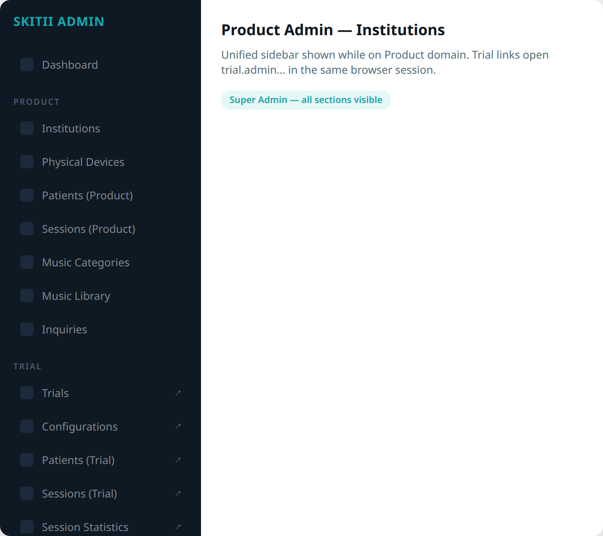

**Three sections** in every app (empty sections hidden):

```
Dashboard
────────────────
PRODUCT          → product.admin… URLs
  Institutions, Devices, Patients (Product), Sessions (Product),
  Music, Inquiries, …
────────────────
TRIAL            → trial.admin… URLs
  Trials, Configurations, Patients (Trial), Sessions (Trial),
  Session Statistics, Weekly Statistics
────────────────
ADMINISTRATION   → product.admin… URLs
  Users, Roles & Permissions, Audit History
```

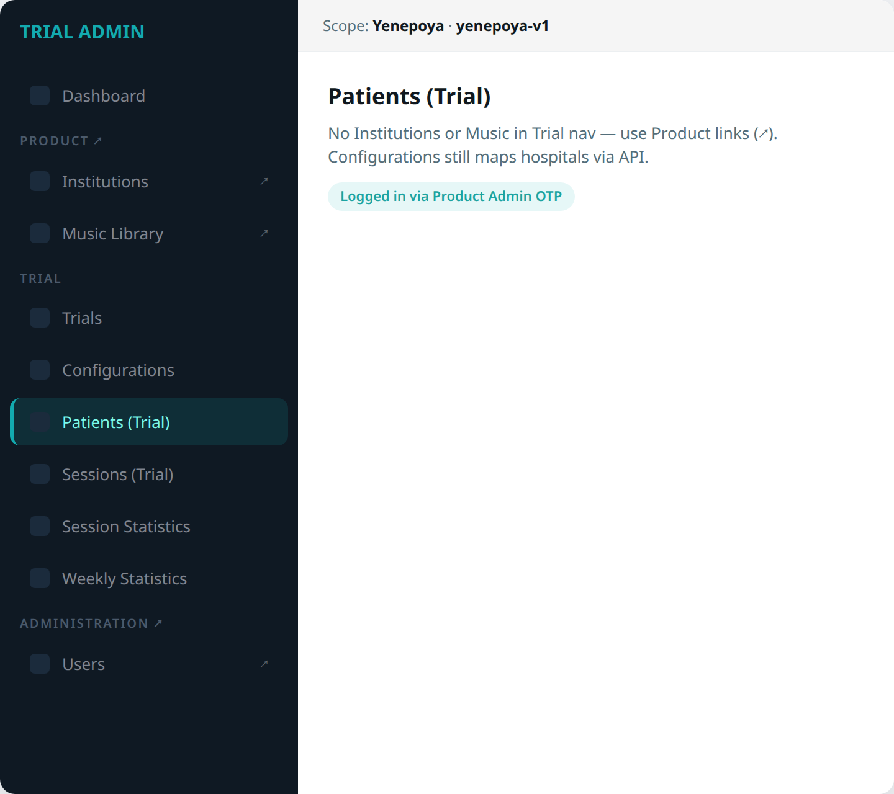

- **In-app** items (current panel): solid highlight, same origin  
- **External** items (other panel): **↗** opens Product or Trial URL  
- **Patients** and **Sessions** appear twice with **(Product)** / **(Trial)** labels  

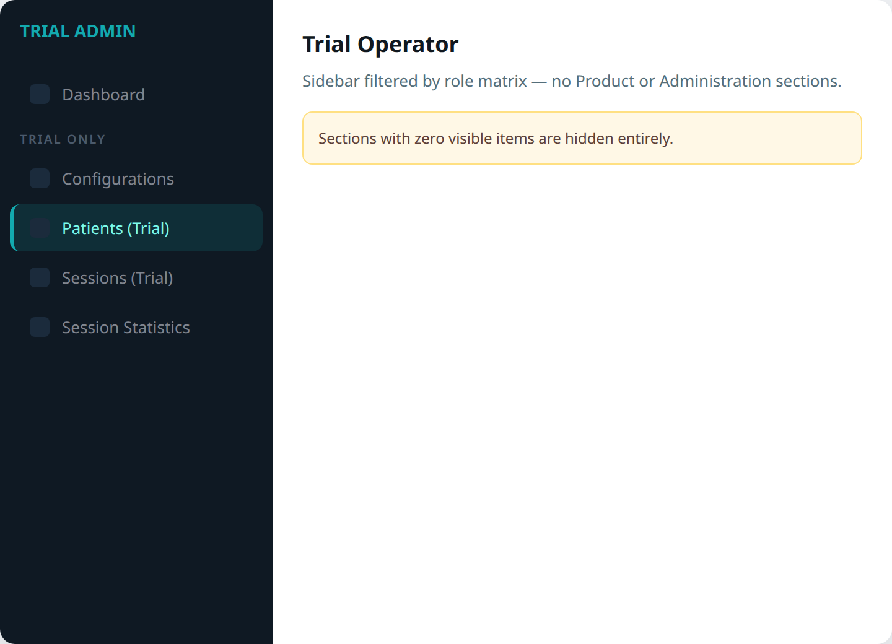

---

## 4. Information architecture diagram

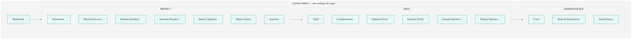

### 4.1 Product Admin modules

| Key | Sidebar label | Route |
|-----|---------------|-------|
| `product.dashboard` | Dashboard | `/dashboard` |
| `product.institutions` | Institutions | `/institutions` |
| `product.devices` | Physical Devices | `/devices` |
| `product.patients` | Patients (Product) | `/patients` |
| `product.sessions` | Sessions (Product) | `/sessions` |
| `product.music_categories` | Music Categories | `/category` |
| `product.music_library` | Music Library | `/music` |
| `product.email_categories` | Email Categories | `/email-templates/categories` |
| `product.email_templates` | Email Templates | `/email-templates` |
| `product.inquiries` | Inquiries | `/inquiries` |
| `product.blog_topics` | Blog Topic | `/blogs/categories` |
| `product.blogs` | Blogs | `/blogs` |
| `product.podcast_topics` | Podcast Topic | `/podcasts/categories` |
| `product.podcasts` | Podcasts | `/podcasts` |
| `product.episodes` | Episodes | `/episodes` |
| `product.users` | Users | `/users` |
| `product.roles` | Roles & Permissions | `/roles` |
| `product.audit` | Audit History | `/audit` |

### 4.2 Trial Admin modules (slim nav)

| Key | Sidebar label | Route |
|-----|---------------|-------|
| `trial.dashboard` | Dashboard | `/dashboard` |
| `trial.trials` | Trials | `/trials` |
| `trial.configurations` | Configurations | `/configurations` |
| `trial.patients` | Patients (Trial) | `/patients` |
| `trial.sessions` | Sessions (Trial) | `/sessions` |
| `trial.statistics` | Session Statistics | `/statistics` |
| `trial.weekly_statistics` | Weekly Statistics | `/weekly-statistics` |

**Removed from Trial sidebar (not deleted from platform):**

| Was in Trial | Now |
|--------------|-----|
| Institutions (read-only list) | **Product → Institutions** (`productType: SKITII_TRIAL`) |
| Music (control pool preview) | **Product → Music Library** (`controlPatientMusic`) |

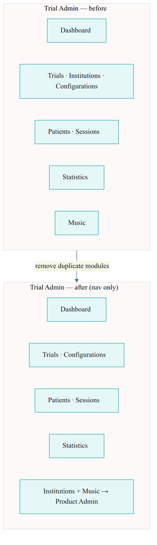

**Configurations** stays in Trial: create mapping still uses `adminInstitutions` API in the form — no separate Institutions menu item.

---

## 5. Role + module access (all users)

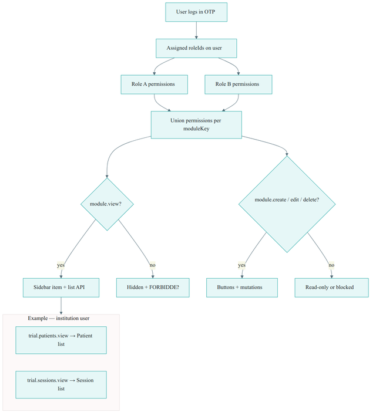

Access is **always** computed the same way:

```
effectivePermissions(user) =
  SUPER_ADMIN → all modules, all actions
  else        → union of all adminRolePermissions for user's roleIds
```

| Check | Result |
|-------|--------|
| `permissions['trial.patients'].view` | User sees **Patients (Trial)** in sidebar and can call patient **list** API |
| `permissions['trial.patients'].create` | **Add patient** button + create mutation |
| `permissions['trial.patients'].edit` | **Edit** + update mutation |
| Missing **view** | No sidebar item, route blocked, list API **FORBIDDEN** |

### 5.1 Institution users (hospitals)

Institution accounts are **not** limited to a single global `INSTITUTION` flag for admin console access. They receive **assignable roles** like internal staff:

| Example role | Typical modules | What they can open |
|--------------|-----------------|-------------------|
| **Institution Trial Operator** | `trial.patients` view/create/edit, `trial.sessions` view | Trial patient list, session list (scoped to their institute via existing API rules) |
| **Institution Trial Read-only** | `trial.patients` view, `trial.sessions` view | Lists and detail only — no create/edit |
| **Institution Product Staff** | `product.patients` view, `product.sessions` view | Product Admin patient/session modules for their hospital |
| **No trial modules** | — | No Trial Admin links in sidebar; Product-only if granted |

**Important:** `INSTITUTION` remains a **user type** (hospital account, linked to `institutions` profile). **What they can do** in each app comes from **roleIds → module matrix**, not from the enum alone.

**Data scope** (which hospital’s patients) stays as today — `institutionId` on the user/profile and API filters. **Module permission** only answers: “may this user open Patients at all?” and “create vs view-only?”.

### 5.2 Internal admin users

Same model. Examples:

| Role | Modules |
|------|---------|
| **Super Admin** | All (bypass) |
| **Trial Operator** | All `trial.*` as configured |
| **Music Manager** | `product.music_*` only |
| **Content Manager** | `product.blog_*`, `product.podcast_*`, `product.episodes` |
| **User Admin** | `product.users`, `product.roles` |

### 5.3 Future roles (no code change for each new role)

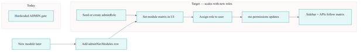

| Step | Who | Action |
|------|-----|--------|
| 1 | Super Admin | Create role e.g. “Regional Trial Auditor” in **Roles** UI |
| 2 | Super Admin | Tick modules: `trial.statistics` view, `trial.patients` view — no create/edit |
| 3 | Super Admin | Assign role on **Users** (internal or institution user) |
| 4 | System | Next `me` call returns new permissions; sidebar and APIs update |

**New screen in future:** add one row to `adminNavModules` + wire resolver to a module key — then include that key in role matrices. **No** new `if (role === 'XYZ')` in frontend or backend.

### 5.4 System vs assignable roles

| Kind | Examples | Editable matrix |
|------|----------|-----------------|
| **System** | `SUPER_ADMIN` (bypass), legacy `ADMIN` during migration | Super Admin only or view-only |
| **Assignable** | Trial Operator, Institution Trial Staff, Music Manager, Content Manager, … | Super Admin / User Admin with `product.roles` |
| **User type flags** | `INSTITUTION`, `CLINICAL_VALIDATION` | Not a permission matrix — account type + institution link |

---

## 6. User management (UI)

### 6.1 User populations (one `users` collection)

| Population | Account type | Managed in UI |
|------------|--------------|---------------|
| **Internal admins** | Skitii staff email | **Users** — create, assign **roleIds**, block |
| **Institution users** | Hospital email + `institutions` profile | **Users** (institution tab/filter) **or** Institutions detail → assign roles; approve/block stays on Institutions |
| **Clinical validation** | `CLINICAL_VALIDATION` | Seed / special roles as needed |

Use **one Users module** with filters (Internal / Institution / All). Assign **one or more roles** per user; effective permissions = **union** of all roles.

### 6.2 Roles UI

| Capability | Spec |
|------------|------|
| **List roles** | System + custom; archive custom roles not in use |
| **Permission matrix** | Rows = `adminNavModules` keys; columns = View / Create / Edit / Delete |
| **Save** | Atomic; audit log records before/after |
| **New role** | Empty matrix → Super Admin ticks modules; no deploy |

### 6.3 Permission actions (reference)

| Action | UI | API |
|--------|-----|-----|
| **view** | Sidebar + list/detail | Query |
| **create** | Add / New | Create mutation |
| **edit** | Save / approve / block | Update mutation |
| **delete** | Delete / archive | Delete mutation |

### 6.4 Administration modules

| Module | Spec |
|--------|------|
| **Users** | List/create/edit all console users; assign **roleIds**; block/unblock |
| **Roles** | Role CRUD + matrix editor |
| **`me` API** | `{ id, email, userType, institutionId?, roleIds, permissions }` |
| **API guards** | `PermissionsGuard(moduleKey, action)` on every admin resolver |

---

## 7. Database architecture

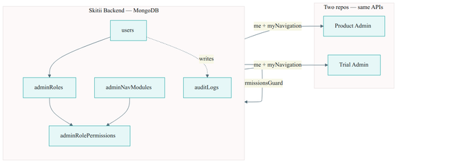

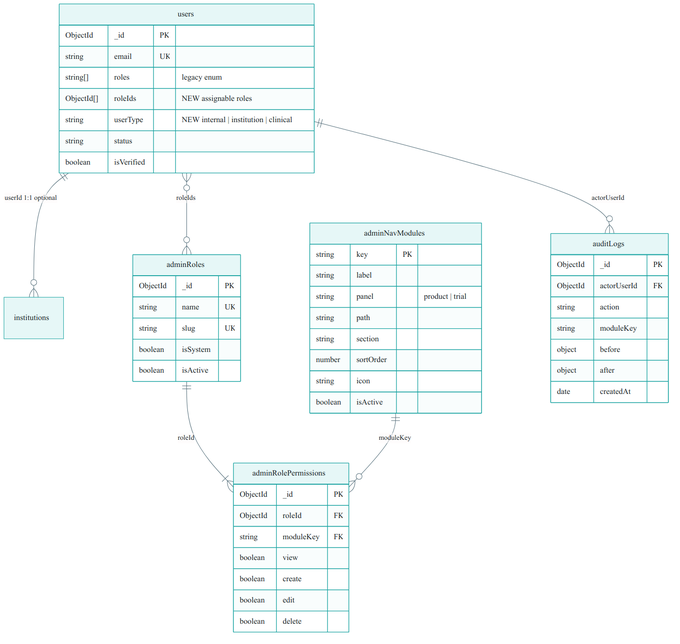

**Database:** Skitii Backend MongoDB (Auth / Product DB). Trial Backend **reads** the same `users` + RBAC collections — does not duplicate them.

### 7.1 Collection summary

| Collection | Change | Purpose |
|------------|--------|---------|
| `users` | **Alter** | Add `roleIds[]`, `userType`; keep legacy `roles[]` during migration |
| `adminRoles` | **New** | Role definitions (system + custom) |
| `adminRolePermissions` | **New** | Module matrix per role: view / create / edit / delete |
| `adminNavModules` | **New** | Sidebar catalog (keys, labels, panel, path) |
| `auditLogs` | **New** (audit sprint) | Append-only action history |
| `institutions` | **No schema change** | Still 1:1 with institution users via `userId` |

---

### 7.2 Current state (today)

**`users`** — existing fields only:

| Field | Type | Notes |
|-------|------|-------|
| `_id` | ObjectId | |
| `email` | string | unique, lowercase |
| `roles` | string[] | `ADMIN` \| `INSTITUTION` \| `CLINICAL_VALIDATION` only |
| `status` | string | `PENDING` \| `APPROVED` \| `REJECTED` \| `BLOCKED` |
| `statusReason` | string \| null | |
| `isVerified` | boolean | |
| `version` | number | |
| `createdAt` / `updatedAt` | Date | |

**Missing today:** no `roleIds`, no permission collections, no nav catalog, no per-module ACL.

---

### 7.3 Changes to `users`

| Field | Type | Required | Description |
|-------|------|----------|-------------|
| `roleIds` | ObjectId[] | default `[]` | References `adminRoles._id`. **Effective access** comes from here. |
| `userType` | string | yes | `internal` \| `institution` \| `clinical` — account class (not permission) |
| `roles` | string[] | keep | Legacy enum during migration; eventually derived or deprecated for console access |

**Rules**

- Internal admin: `userType: internal`, one or more `roleIds` (e.g. Super Admin, Trial Operator).  
- Hospital account: `userType: institution`, linked `institutions.userId`, `roleIds` e.g. Patient Viewer or Patient Manager.  
- A user may have **multiple** `roleIds`; permissions = **union** (OR) across roles.  
- `status: BLOCKED` still blocks login regardless of permissions.

**New indexes**

```javascript
db.users.createIndex({ roleIds: 1 })
db.users.createIndex({ userType: 1, status: 1 })
```

**Example — view-only vs full patient access (same module, different roles)**

User A:

```json
{
  "email": "viewer@hospital.com",
  "userType": "institution",
  "roleIds": ["<PatientViewerRoleId>"],
  "status": "APPROVED"
}
```

User B:

```json
{
  "email": "coordinator@hospital.com",
  "userType": "institution",
  "roleIds": ["<PatientManagerRoleId>"],
  "status": "APPROVED"
}
```

---

### 7.4 New collection: `adminRoles`

| Field | Type | Required | Description |
|-------|------|----------|-------------|
| `_id` | ObjectId | auto | |
| `name` | string | yes | Display name, e.g. "Patient Manager" |
| `slug` | string | yes | Unique key, e.g. `patient-manager` |
| `description` | string | no | Optional help text in Roles UI |
| `isSystem` | boolean | yes | `true` = seeded, matrix locked or Super-Admin-only edit |
| `isActive` | boolean | yes | `false` = cannot assign to new users |
| `createdAt` / `updatedAt` | Date | auto | |

**Indexes**

```javascript
db.adminRoles.createIndex({ slug: 1 }, { unique: true })
db.adminRoles.createIndex({ isActive: 1, name: 1 })
```

**Seed examples**

| slug | name | isSystem |
|------|------|----------|
| `super-admin` | Super Admin | true |
| `full-product-admin` | Full Product Admin | true |
| `trial-operator` | Trial Operator | false |
| `patient-viewer` | Patient Viewer | false |
| `patient-manager` | Patient Manager | false |

---

### 7.5 New collection: `adminRolePermissions`

One document per **(roleId, moduleKey)** pair.

| Field | Type | Required | Description |
|-------|------|----------|-------------|
| `_id` | ObjectId | auto | |
| `roleId` | ObjectId | yes | FK → `adminRoles._id` |
| `moduleKey` | string | yes | FK → `adminNavModules.key` |
| `view` | boolean | yes | List, sidebar, read APIs |
| `create` | boolean | yes | Add / create mutations |
| `edit` | boolean | yes | Update / approve / block |
| `delete` | boolean | yes | Delete / archive |
| `updatedAt` | Date | auto | |

**Indexes**

```javascript
db.adminRolePermissions.createIndex(
  { roleId: 1, moduleKey: 1 },
  { unique: true }
)
db.adminRolePermissions.createIndex({ moduleKey: 1 })
```

**Example — Patient Viewer vs Patient Manager on `trial.patients`**

| role | moduleKey | view | create | edit | delete |
|------|-----------|------|--------|------|--------|
| Patient Viewer | `trial.patients` | true | false | false | false |
| Patient Manager | `trial.patients` | true | true | true | false |

**Validation (application layer)**

- If `create`, `edit`, or `delete` is true → `view` must be true.  
- Unknown `moduleKey` rejected on save.

**Permission resolution query (conceptual)**

```javascript
// For user.roleIds = [id1, id2]
// Merge: view = OR(all rows), same for create/edit/delete per moduleKey
```

---

### 7.6 New collection: `adminNavModules`

Sidebar catalog — **not** per user; shared by all apps.

| Field | Type | Required | Description |
|-------|------|----------|-------------|
| `key` | string | yes | Primary key, e.g. `trial.patients` |
| `label` | string | yes | UI label, e.g. "Patients (Trial)" |
| `panel` | string | yes | `product` \| `trial` |
| `path` | string | yes | In-app route, e.g. `/patients` |
| `section` | string | no | Sidebar group: Product, Trial, Administration |
| `sortOrder` | number | yes | Order within section |
| `icon` | string | no | Lucide icon name |
| `isActive` | boolean | yes | Inactive = hidden from catalog |
| `createdAt` / `updatedAt` | Date | auto | |

**Indexes**

```javascript
db.adminNavModules.createIndex({ key: 1 }, { unique: true })
db.adminNavModules.createIndex({ panel: 1, section: 1, sortOrder: 1 })
```

**Example document**

```json
{
  "key": "trial.patients",
  "label": "Patients (Trial)",
  "panel": "trial",
  "path": "/patients",
  "section": "Trial",
  "sortOrder": 40,
  "icon": "Users",
  "isActive": true
}
```

**Not stored in DB:** `baseUrl` per environment — resolved from `PRODUCT_ADMIN_URL` / `TRIAL_ADMIN_URL` at runtime.

**Removed keys (Trial slim nav):** do not seed `trial.institutions` or `trial.music`.

---

### 7.7 New collection: `auditLogs` (audit sprint)

Append-only. No update/delete API.

| Field | Type | Description |
|-------|------|-------------|
| `_id` | ObjectId | |
| `createdAt` | Date | UTC |
| `actorUserId` | ObjectId | → `users._id` |
| `actorEmail` | string | Snapshot |
| `actorRoleIds` | ObjectId[] | Snapshot at action time |
| `action` | string | `create` \| `update` \| `delete` \| `assign_role` \| `set_permissions` \| … |
| `moduleKey` | string | e.g. `product.users` |
| `entityType` | string | `User`, `AdminRole`, `Institution`, … |
| `entityId` | string | Target id |
| `summary` | string | One-line text |
| `before` | object \| null | JSON snapshot |
| `after` | object \| null | JSON snapshot |
| `requestId` | string | |
| `ip` | string | |
| `userAgent` | string | |

**Indexes**

```javascript
db.auditLogs.createIndex({ createdAt: -1 })
db.auditLogs.createIndex({ moduleKey: 1, createdAt: -1 })
db.auditLogs.createIndex({ actorUserId: 1, createdAt: -1 })
db.auditLogs.createIndex({ entityType: 1, entityId: 1, createdAt: -1 })
```

---

### 7.8 Enum & code changes (Skitii Backend)

| Area | Change |
|------|--------|
| `Role` enum | Add `SUPER_ADMIN = 'SUPER_ADMIN'` (optional JWT marker; real ACL from `roleIds`) |
| `UserType` enum | **New:** `internal`, `institution`, `clinical` |
| JWT payload | Keep small: `sub`, `email`, `status` — **do not** embed full permission matrix |
| `JwtStrategy` | Load user + compute permissions from `roleIds` for `me` |
| `PermissionsGuard` | Replace coarse `@Roles(ADMIN)` over time with `@RequirePermission(moduleKey, action)` |

---

### 7.9 Migration plan

| Step | Action |
|------|--------|
| 1 | Create collections `adminRoles`, `adminRolePermissions`, `adminNavModules` |
| 2 | Seed `adminNavModules` (all `product.*` + slim `trial.*` keys) |
| 3 | Seed system roles + full matrix for Super Admin / Full Product Admin |
| 4 | Seed **Patient Viewer** and **Patient Manager** with `trial.patients` rows (see §7.5) |
| 5 | Migration script: existing `roles: ['ADMIN']` users → `userType: internal`, `roleIds: [<full-product-admin>]` |
| 6 | Migration script: existing `roles: ['INSTITUTION']` → `userType: institution`, default `roleIds` per policy (e.g. none until assigned) |
| 7 | Add `roleIds`, `userType` to `users` schema; deploy backend |
| 8 | Deploy admin UI; stop relying on `roles.includes('ADMIN')` alone for module access |
| 9 | (Later) Add `auditLogs` + writer |

**Rollback:** keep legacy `roles[]` populated until all apps use `me.permissions`.

---

### 7.10 How DB rows become `me.permissions`

```
1. Load user by JWT sub
2. If user has Super Admin roleId → all module keys all true
3. Else query adminRolePermissions where roleId in user.roleIds
4. Group by moduleKey; for each action (view/create/edit/delete) use OR across roles
5. Return:
   {
     permissions: {
       "trial.patients": { view: true, create: false, edit: false, delete: false },
       "trial.sessions": { view: true, create: false, edit: false, delete: false }
     }
   }
6. myNavigation filters adminNavModules where permissions[key].view === true
```

---

### 7.11 APIs (data layer consumers)

| API | Reads from |
|-----|------------|
| `me` | `users` + `adminRolePermissions` (via `roleIds`) |
| `myNavigation` | `adminNavModules` + `me.permissions` |
| Users CRUD | `users`, `adminRoles` |
| Roles CRUD | `adminRoles`, `adminRolePermissions` |
| `PermissionsGuard` | Cached `me.permissions` or same loader |
| Trial Backend | Read-only: `users`, `adminRoles`, `adminRolePermissions` (same DB connection as today for Auth) |

---

### 7.12 Unchanged collections (reference)

| Collection | RBAC impact |
|------------|-------------|
| `institutions` | No change; scope filter for institution users |
| `refresh_tokens` / OTP | No change |
| `trials`, `patients`, `sessions`, … (Trial DB) | No RBAC schema change; guards use Product RBAC for admin APIs |

---

## 8. Permission → sidebar flow

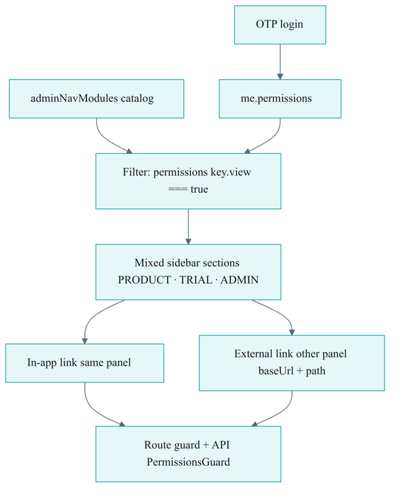

```
1. OTP login → JWT (roles only, small)
2. Fetch me.permissions
3. Load adminNavModules catalog
4. visibleItems = modules where permissions[key].view === true
5. Group by section (Product | Trial | Administration)
6. href = in-app path OR baseUrl + path (external ↗)
7. Route guard + API guard on create/edit/delete
```

---

## 9. Cross-domain authentication

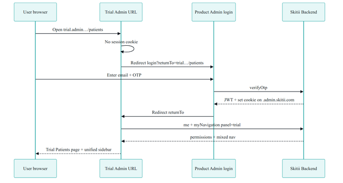

### 9.1 Recommended: shared parent domain

```
product.admin.skitii.com   → Product Admin
trial.admin.skitii.com     → Trial Admin
```

- Login only on **Product Admin** (`/login`)  
- Cookie: `HttpOnly`, `Secure`, `SameSite=Lax`, domain=`.admin.skitii.com`  
- Trial app: if no cookie → redirect  
  `product.admin.skitii.com/login?returnTo=https://trial.admin.skitii.com/patients`  
- After OTP: set cookie → redirect `returnTo`  

### 9.2 Trial Admin changes

- Remove standalone login as primary path (redirect to Product)  
- On boot: `me` + `myNavigation('trial')`  
- Render unified sidebar (mixed Product ↗ + Trial in-app)  

### 9.3 Product Admin changes

- After `verifyOtp`, honor safe `returnTo` (allowlist Product + Trial origins)  
- `myNavigation('product')` for sidebar  

---

## 10. Institutions & Music — Product only

### 10.1 Institutions

| Capability | Product Admin | Trial Admin |
|------------|---------------|-------------|
| Create hospital | Yes — set `productType: SKITII_TRIAL` for trial sites | No page |
| Approve / reject / block | Yes | No |
| List all / filter Trial | Yes | No |
| Pick hospital in Configurations | — | API only (dropdown) |

**Operator flow:** create trial hospital in Product → open Trial → Configurations → map institute + trial.

### 10.2 Music

| Capability | Product Admin | Trial Admin |
|------------|---------------|-------------|
| Upload / edit tracks | Yes | Removed |
| `controlPatientMusic` flag | Yes | Removed |
| Preview control pool | Yes (can add) | Was duplicate — use Product link |

---

## 11. Implementation phases

| Phase | Deliverable |
|-------|-------------|
| **A** | RBAC schema, `me`, Users/Roles APIs (Product Backend) |
| **B** | Product Admin Users + Roles UI; `PermissionsGuard` on Product APIs |
| **C** | `adminNavModules` seed + `myNavigation`; replace static `menuConfig` in Product |
| **D** | Shared session + Trial redirect login; Trial `myNavigation`; slim Trial routes |
| **E** | Trial Backend `trial.*` guards |
| **F** | Audit log (4-day sprint) |

**Related task PDFs:**

- `output/Skitii_Admin_RBAC_10Day_Task_List.pdf`  
- `output/Skitii_Admin_Audit_4Day_Task_List.pdf`  
- `output/Skitii_Trial_Admin_8Day_Task_List.pdf` (clinical modules; update nav section)  

---

## 12. Environment variables

```bash
# Both admin apps
NEXT_PUBLIC_PRODUCT_ADMIN_URL=https://product.admin.skitii.com
NEXT_PUBLIC_TRIAL_ADMIN_URL=https://trial.admin.skitii.com
NEXT_PUBLIC_AUTH_LOGIN_URL=https://product.admin.skitii.com/login
```

---

## 13. Design principles

1. **Role + module only** — never `if (user.email === …)` or hardcoded role names for feature access  
2. **One catalog, two apps** — never maintain two permission trees  
3. **Backend enforces** — sidebar hiding is UX only  
4. **JWT stays small** — permissions via `me`, not token claims  
5. **Institution users use same RBAC** — assign roles; patient list = `*.patients.view`  
6. **Union of roles** — user with two roles gets combined permissions (OR per action)  
7. **Future-proof** — new role = DB row + matrix; new module = `adminNavModules` + guard  
8. **Duplicate labels need suffixes** — Patients (Product) vs Patients (Trial)  

---

## 14. Handoff checklist

- [ ] DB migration: `users.roleIds`, `users.userType`, new collections seeded  
- [ ] Patient Viewer vs Patient Manager rows in `adminRolePermissions` for `trial.patients`  
- [ ] Users have **roleIds[]**; `me` returns merged **permissions**  
- [ ] Institution user with `trial.patients.view` sees Trial patient list; without it, blocked  
- [ ] Super Admin + Trial Operator + **Institution Trial Staff** roles in seed  
- [ ] Product login + cookie works on both subdomains  
- [ ] Trial `/institutions` and `/music` removed or redirect to Product  
- [ ] New role can be added in UI without code deploy  
- [ ] `PermissionsGuard` blocks API when action not granted  

---

*Skitii Admin — Unified Navigation & User Management · September 2026*
