# Skitii Trial Admin Panel — Design Overview
**Audience:** Leadership / product review  
**App:** Skitii Trial Admin Frontend (Next.js · port 3020)  
**APIs:** Product Backend (OTP / JWT) · Trial Backend GraphQL (clinical data)  
**Date:** August 2026  
**Author:** Swapnil Sagvekar  

---

## 1. Purpose

A web admin console for Skitii clinical trial operations (Yenepoya and future institutes). Central admins can:

1. **Set up** trials, institutions, and institute↔trial mappings  
2. **Operate** patient enrollment and therapy sessions  
3. **Analyze** session and weekly-form completion  
4. **Browse** the control-group music pool  

Tablet clinicians use the HNF mobile app; this panel is for **central / trial admins**.

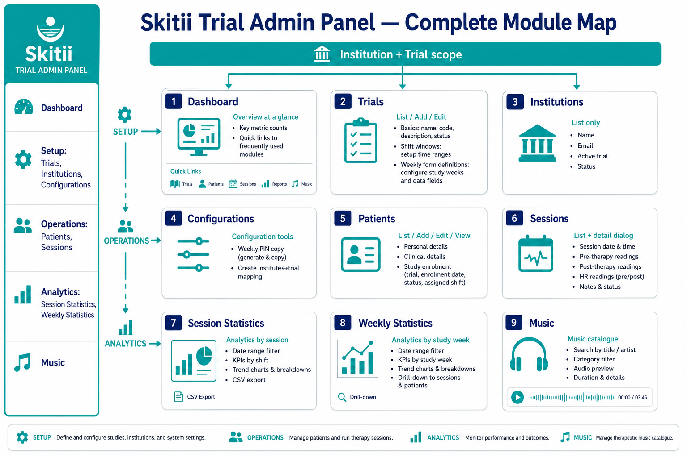

---

## 2. Information architecture (sidebar)

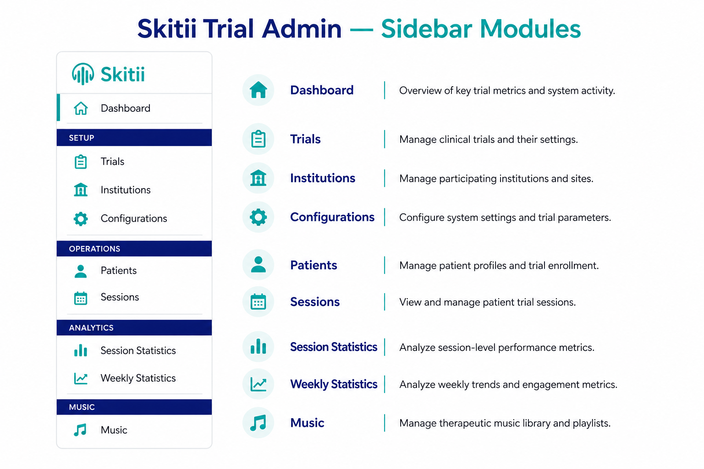

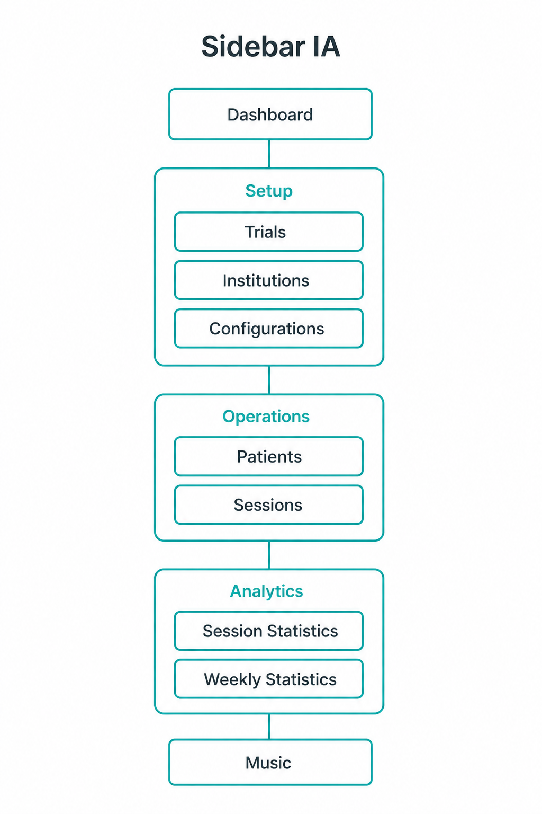

```
Dashboard
────────────────
Setup
  · Trials
  · Institutions
  · Configurations
────────────────
Operations
  · Patients
  · Sessions
────────────────
Analytics
  · Session Statistics
  · Weekly Statistics
────────────────
Music
```

| Section | Role |
|---------|------|
| **Dashboard** | Counts + shortcuts |
| **Setup** | Protocol & mapping (infrequent) |
| **Operations** | Day-to-day clinical data (scoped) |
| **Analytics** | KPIs & drill-downs (scoped) |
| **Music** | Control music catalogue preview |

**Global scope bar** (Institution + Trial) appears on Dashboard, Patients, Sessions, and both Statistics pages.

---

## 3. Setup → Scope → Operations

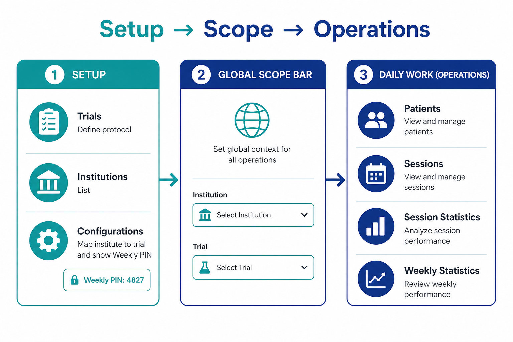

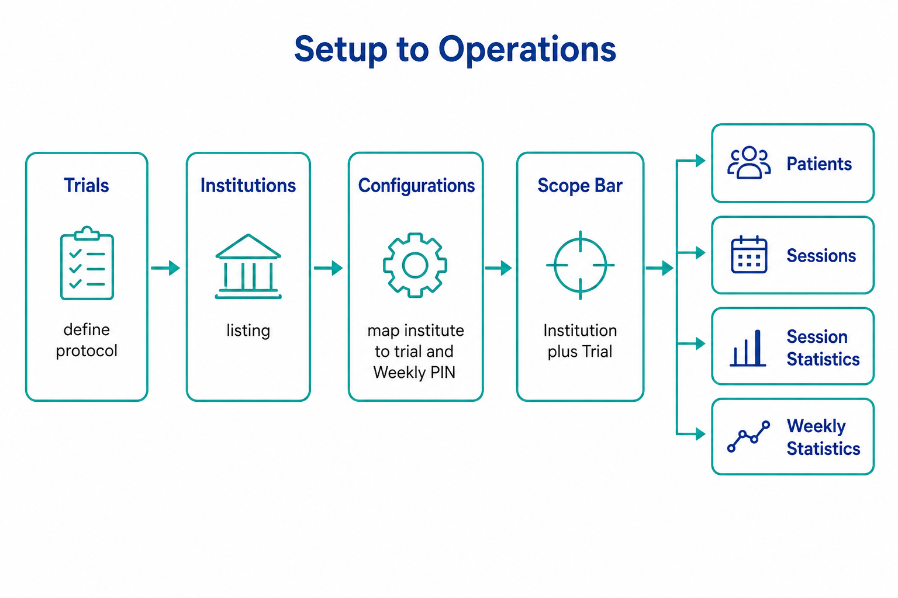

```
Setup: Trials ──define──► Protocol (shifts, weekly steps)
Setup: Configurations ──map──► Institution runs that protocol
         │
         ▼
Scope bar (Institution + Trial)
         │
         ├── Operations: Patients / Sessions
         └── Analytics: Session stats / Weekly stats

Dashboard ──overview + shortcuts──► any of the above
Music ──independent catalogue preview──
```

---

## 4. Shell & design language

| Element | Design choice |
|---------|----------------|
| Layout | Collapsible left sidebar · top bar (page title, theme, logout) |
| Scope | Institution / Trial selects above content when needed |
| Brand | Teal primary accents, Skitii logo |
| Theme | Light / dark |
| Components | Cards, badges, tables, dialogs, skeletons, toasts |
| Auth | Email OTP via Product Backend → JWT for Trial GraphQL |

---

## 5. Dashboard

**Route:** `/dashboard`

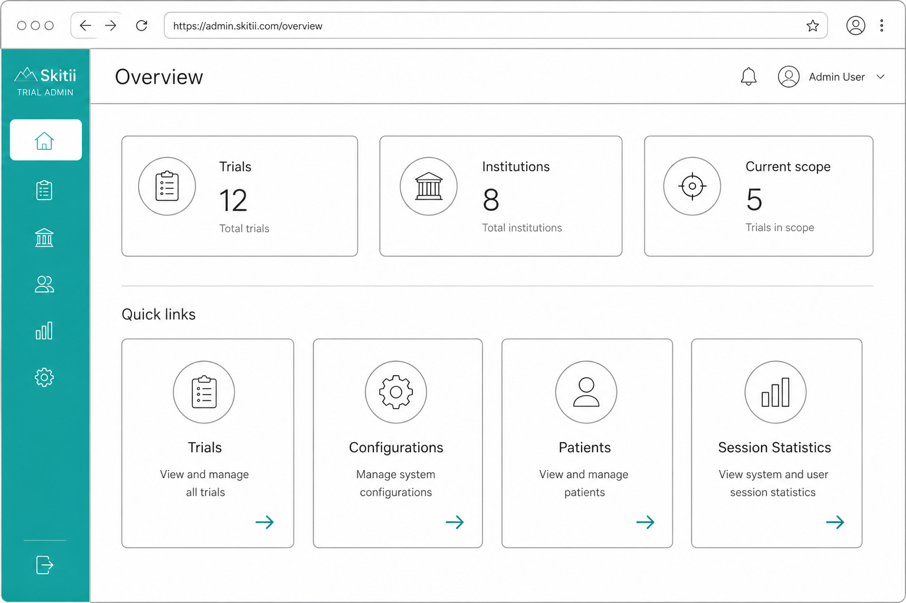

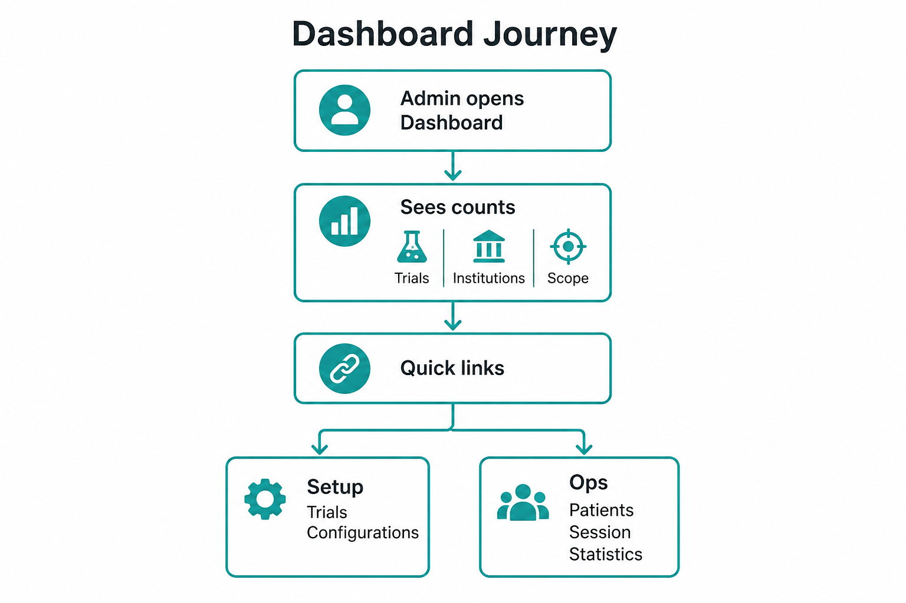

**What this module shows**

| Block | Content |
|-------|---------|
| **Trials** card | Total protocols · how many are *active* |
| **Institutions** card | Count of trial institutes |
| **Current scope** card | Selected trial id and institution |
| **Quick links** | Jump to Trials, Configurations, Patients, Session Statistics |

No create/edit forms here — overview and navigation only.

---

## 6. Setup

### 6.1 Trials

**Routes:** `/trials` · `/trials/new` · `/trials/[trialId]/edit`

**What we are adding in this module**

| Screen | What admin can do |
|--------|-------------------|
| **List** | See all protocols with status badge (active / inactive / completed); open edit; start **Create draft** |
| **Add (Create draft)** | Define a new trial protocol on a dedicated page |
| **Edit** | Update the same fields as create; change status |

**Add / Edit trial — information captured**

1. **Basics**
   - Trial ID (create only), name, status  
   - Duration (weeks), shifts per day  
   - Weekly form interval (days), form reminder days before expiry  
   - Clinical day start hour (e.g. 4:00 AM clinical-day cut)

2. **Shift windows** (repeatable rows)
   - Shift number, label (Morning / Afternoon / Night)  
   - Start time, end time, crosses-midnight flag  

3. **Weekly form definitions** (repeatable rows)
   - Study week number, label  
   - Ordered step keys for that week (e.g. `vitals, hads, hrv, gad7_phq9`)

Weekly PIN is **not** entered here — it is shown under Configurations and rotated by backend cron.

### 6.2 Institutions

**Route:** `/institutions`

**What we are adding in this module**

| Screen | What admin can do |
|--------|-------------------|
| **List only** | View trial institutes from Auth DB (`SKITII_TRIAL`) |

**Columns shown:** name, email, active trial, number of configurations.

No add/edit of institution master data in Trial Admin (that stays in product/auth). Mapping an institute to a trial is done under **Configurations**.

### 6.3 Configurations

**Route:** `/configurations`

**What we are adding in this module**

| Area | What admin can do |
|------|-------------------|
| **Weekly PIN** | View current 4-digit PIN for the active trial; **copy** to share with institute staff (read-only; no manual rotate in UI) |
| **Create configuration** | Pick institution + trial, set active flag → create institute↔trial mapping |
| **Mapping list** | Table of existing mappings: institution, trial, weekly PIN, status; can update active flag |

Separates **protocol definition** (Trials) from **who runs which protocol** (Configurations).

---

## 7. Operations

### 7.1 Patients

**Routes:** `/patients` · `/patients/new` · `/patients/[id]` · `/patients/[id]/edit`

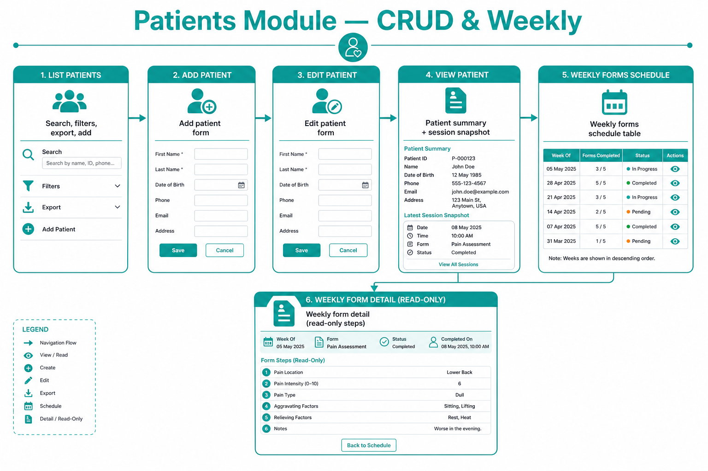

Requires institution + trial scope.

#### Patient list (Read)

**Route:** `/patients`

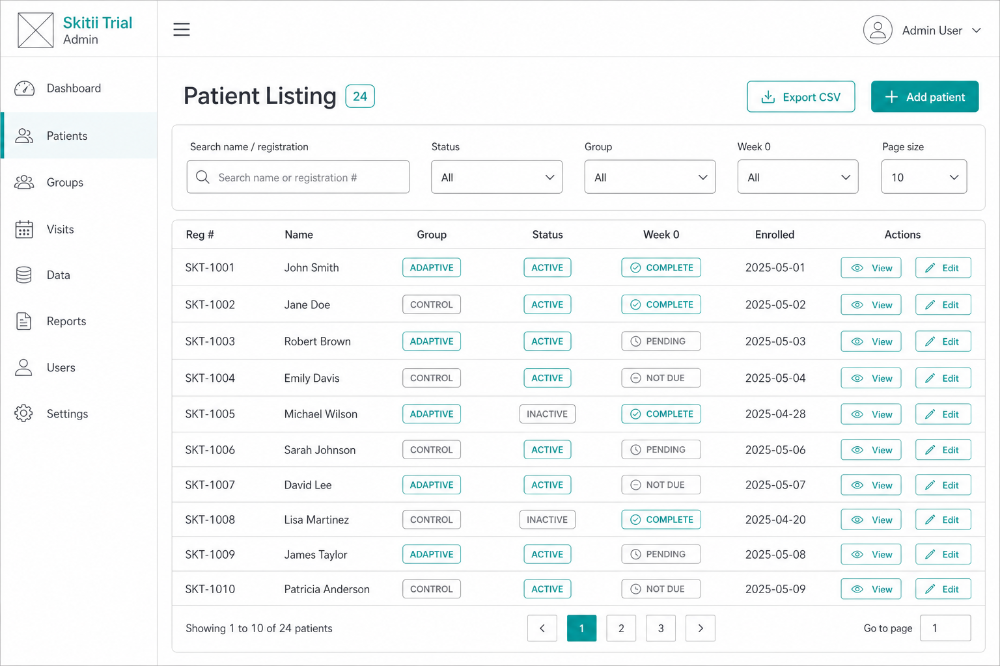

| Capability | Detail |
|------------|--------|
| **Search** | Name or registration number |
| **Filters** | Status (active / completed / withdrawn) · Group (adaptive / control) · Week 0 status · Page size |
| **Table** | Reg # · Name · Group · Status · Week 0 badge · Enrolled date · Actions |
| **Sort** | Registration #, name, group, status, enrolment date |
| **Actions** | View · Edit · **Add patient** · **Export CSV** |

#### Add patient (Create)

**Route:** `/patients/new`

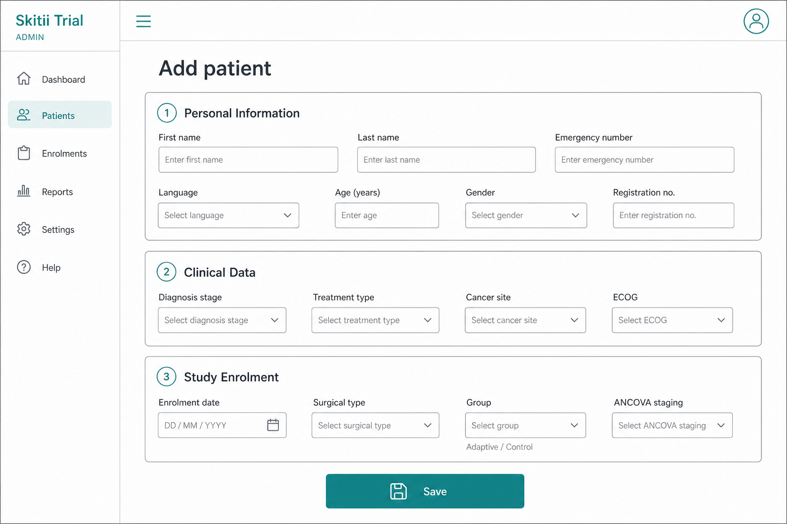

Three form sections on one page:

1. **Personal information** — first/last name, emergency number, language, age, gender, registration # (optional)  
2. **Clinical data** — diagnosis stage, treatment type, cancer site, ECOG  
3. **Study enrolment** — enrolment date, surgical type, group type (adaptive/control), ANCOVA staging  

#### Edit patient (Update)

**Route:** `/patients/[id]/edit`

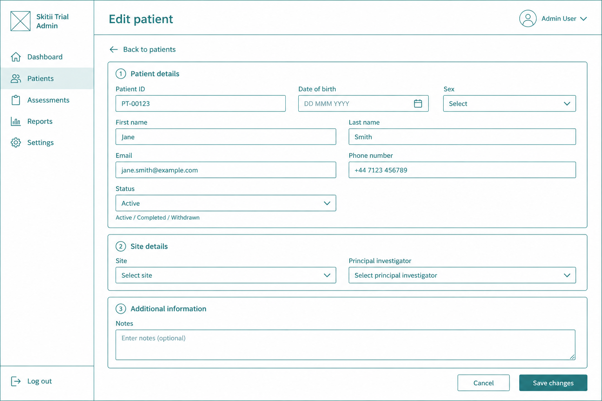

Same fields as add, plus **status** (active / completed / withdrawn). Shown only when the record is still editable.

#### View patient (Read detail)

**Route:** `/patients/[id]`

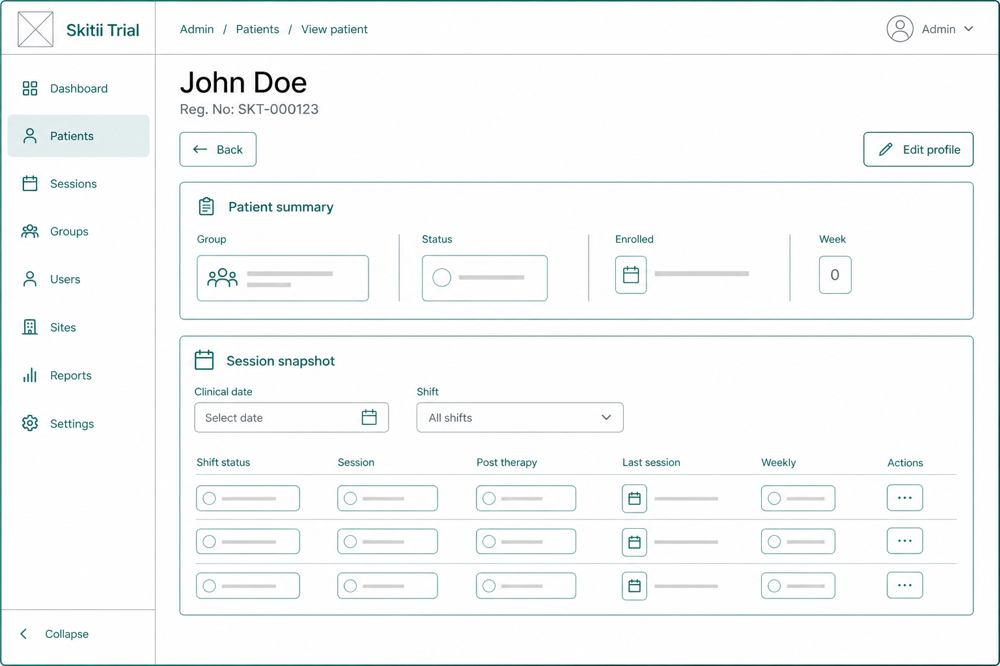

| Area | Content |
|------|---------|
| **Patient summary** | Group, status, enrolled date, Week 0 status |
| **Session snapshot** | Pick clinical date + shift; chips for shift status, session, post therapy, last session, weekly, actions |
| **Actions** | Back to list · Edit profile |

#### Weekly forms schedule (on View patient)

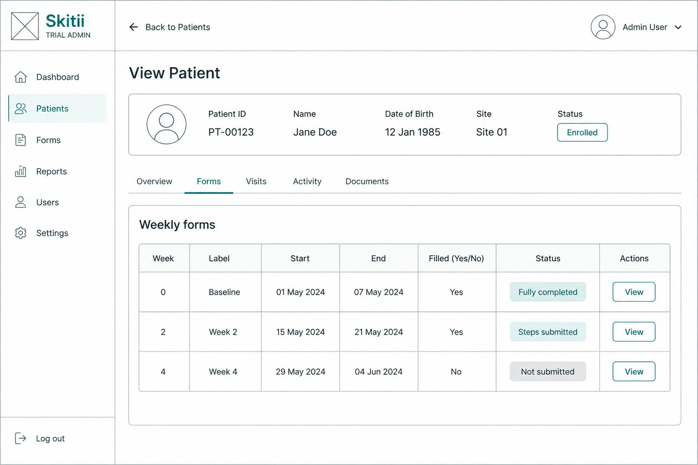

Per-patient schedule from trial `weeklyFormDefinitions`:

| Column | Meaning |
|--------|---------|
| Week / Label | Study week (0, 2, 4, …) and protocol label |
| Start / End | Form window dates |
| Filled | Whether any submission exists |
| Status | not submitted · steps submitted · fully completed |
| Actions | **View** opens read-only form detail when `formId` exists |

#### Weekly form detail (read-only review)

Opened from **View** on a submitted week.

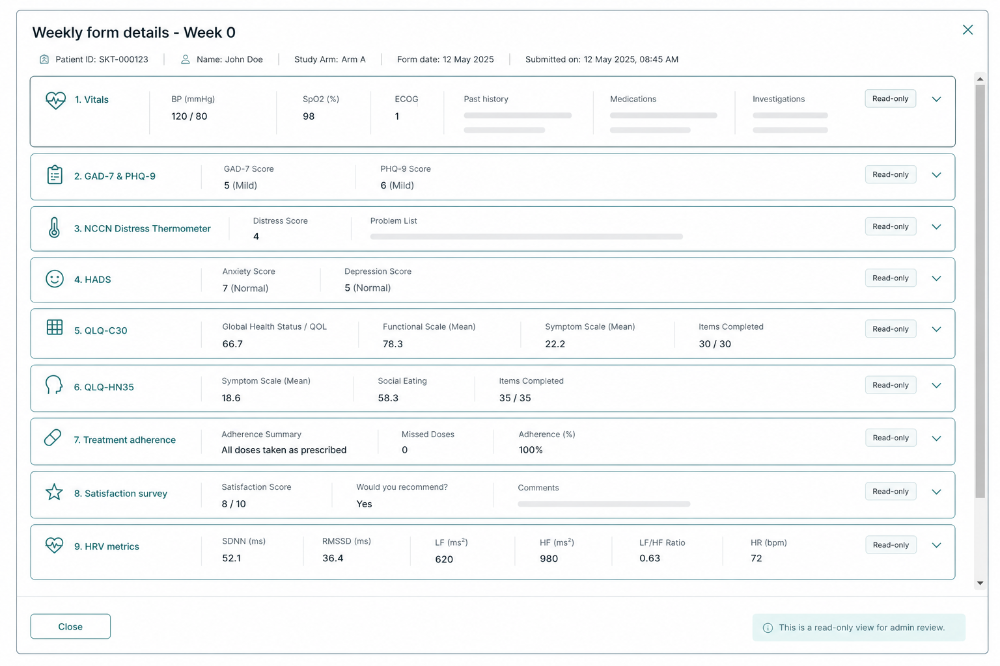

Renders only the steps configured for that week. Possible sections:

| Step key | Admin sees |
|----------|------------|
| `vitals` | Vital signs, past history, current medication, investigations |
| `gad7_phq9` | GAD-7 and PHQ-9 scores |
| `nccn_distress` | Distress thermometer + problem checklist |
| `hads` | HADS-A and HADS-D |
| `qlq_c30` | EORTC QLQ-C30 |
| `qlq_hn35` | EORTC QLQ-H&N35 |
| `treatment_adherence` | Treatment adherence scale |
| `satisfaction_survey` | Week-4 satisfaction survey |
| `hrv` | 5-minute resting HRV summary (after steps submitted) |

HRV section appears only when the form status allows it (fully completed or HRV data present).

**Add / Edit — field reference**

1. **Personal information**
   - First name, last name  
   - Emergency number, language preference (Kannada / English / Hindi / Malayalam)  
   - Age, gender (male / female / other)  
   - Patient ID / registration number (optional)

2. **Clinical data**
   - Diagnosis stage (Stage 1–4)  
   - Treatment type (Radiotherapy / Chemotherapy / Both)  
   - Cancer site  
   - ECOG performance status (0–4)

3. **Study enrolment**
   - Enrolment date  
   - Surgical type (Pre-Operative / Post-Operative)  
   - Group type (adaptive / control)  
   - ANCOVA staging (Pre-Treatment / Early / Mid-late)  
   - Status (active / completed / withdrawn) on edit

### 7.2 Sessions

**Route:** `/sessions`

**What we are adding in this module**

| Screen | What admin can do |
|--------|-------------------|
| **List** | Paginated therapy sessions for the scoped institute/trial; search; filter by status |
| **Detail (dialog)** | Inspect one session without leaving the list |

**List shows / filters:** Active · Completed · Incomplete · Auto-terminated.

**Session detail includes**

- Patient name, device id, duration, shift, session date, wellbeing  
- Termination reason (user ended, timeout, max reached, replaced by new session, …)  
- **Pre-therapy** form snapshot  
- **Post-therapy** form snapshot  
- **HR / phase readings** panel  

Admins do not start sessions here — that happens on the tablet; this module is for review and audit.

---

## 8. Analytics

Both pages need institution + trial scope. Shared pattern:

**Date range** → **KPI cards** → **charts** → **detailed table** → **click-through detail dialog**

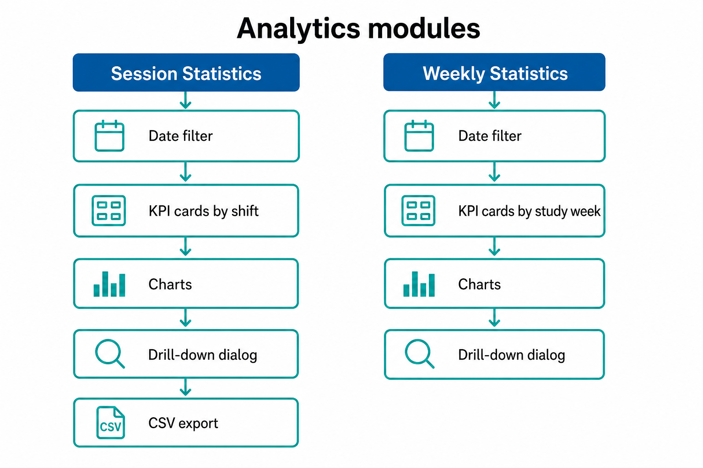

**Shared date filter options:** Today · Last 3 days · Last 7 days · Last 14 days · Custom range (from / to).  
The backend returns the resolved clinical period shown under the filter.

Session ops vs weekly clinical-review compliance are **separate** screens on purpose (different axes: **shift** vs **study week**).

### 8.1 Session Statistics

**Route:** `/statistics`

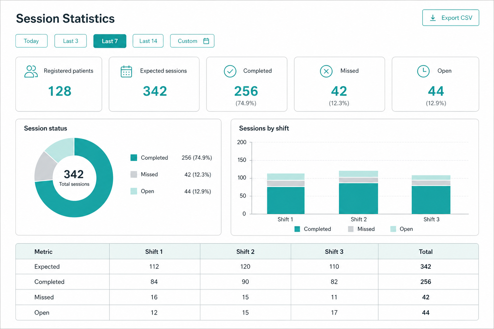

**Purpose:** Enrolment and therapy-session completion for the selected institute + trial.

**What we are adding in this module**

| Area | What admin sees / does |
|------|------------------------|
| **Header action** | **Export CSV** of the current statistics period |
| **Date filter** | Clinical-day range (today / last N / custom) |
| **Open-items banner** | Warns when session slots are still open (window not closed) |
| **KPI cards** (clickable) | Registered patients · Expected sessions · Completed · Missed · Open |
| **Chart — Session status** | Donut / status split: Completed · Missed · Open |
| **Chart — Sessions by shift** | Stacked bars per Shift 1 / 2 / 3 (click segment → details) |
| **Detailed breakdown table** | Rows: Expected · Completed · Missed · Open × columns Shift 1 / 2 / 3 / Total |
| **Drill-down dialog** | Patient list and session slots for the clicked count (optionally filtered by shift) |

**KPI meanings**

| KPI | Meaning |
|-----|---------|
| **Registered patients** | Patients created in the selected period |
| **Expected sessions** | Patient × shift slots due in range |
| **Completed** | Slots with completed post-therapy (completion rate shown) |
| **Missed** | Shift window closed with no post-therapy |
| **Open** | Shift window still active (not closed yet) |

**Drill-down detail dialog can show**

- For **registered:** patient rows created in range  
- For **expected / completed / missed / open:** underlying patient–shift session slots  

Missed only applies **after** the shift window closes. Each table row sums to Expected for that shift.

### 8.2 Weekly Statistics

**Route:** `/weekly-statistics`

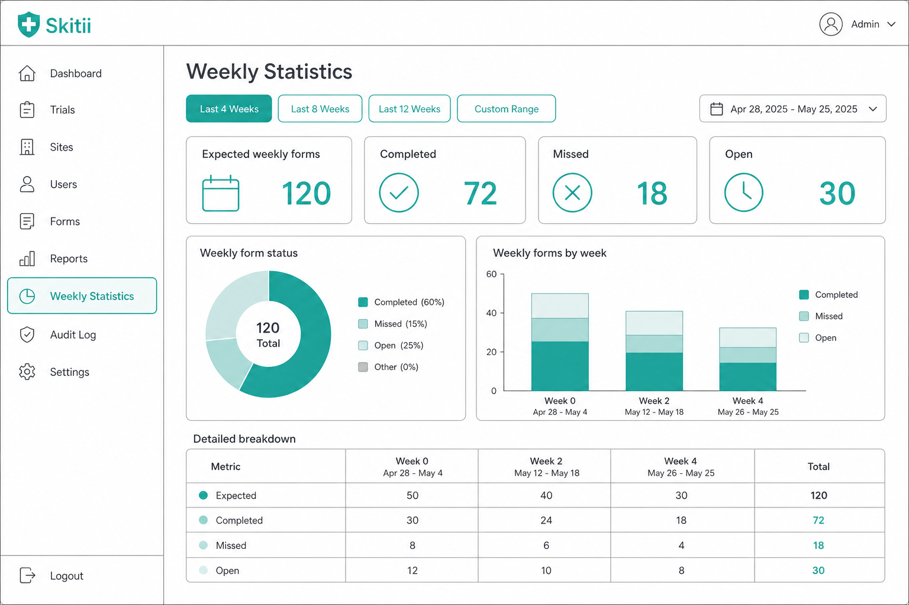

**Purpose:** Weekly clinical-review form completion (Week 0 / 2 / 4 / … from trial `weeklyFormDefinitions`).

**What we are adding in this module**

| Area | What admin sees / does |
|------|------------------------|
| **Date filter** | Same clinical-day presets as session stats |
| **Open-items banner** | Warns when weekly form windows are still open |
| **KPI cards** (clickable) | Expected weekly forms · Completed · Missed · Open |
| **Chart — Weekly form status** | Overall Completed · Missed · Open split |
| **Chart — Weekly forms by week** | Stacked bars per study week (Week 0, 2, 4, …) |
| **Detailed breakdown table** | Rows: Expected · Completed · Missed · Open × columns per study week + Total |
| **Drill-down dialog** | Patients / weekly-form slots for the clicked count (optionally filtered by week) |

**KPI meanings**

| KPI | Meaning |
|-----|---------|
| **Expected weekly forms** | Patient × week windows due in range |
| **Completed** | Forms fully completed in window (completion rate shown) |
| **Missed** | Form window closed and form not fully completed |
| **Open** | Form window still active |

**How it differs from Session Statistics**

| | Session Statistics | Weekly Statistics |
|--|--------------------|-------------------|
| Axis | Therapy **shifts** (1 / 2 / 3) | Study **weeks** from protocol |
| Unit | Session slots | Weekly clinical-review forms |
| Export | CSV from page header | Drill-down / charts (same interaction pattern) |
| Empty state | — | Message if trial has no weekly form definitions |

---

## 9. Music

**Route:** `/music`

**What we are adding in this module**

| Area | What admin can do |
|------|-------------------|
| **Catalogue list** | Browse control-group music tracks from Trial Backend |
| **Search / filter** | Search by title; filter by category (Meditation, Sleep Sounds, Focus Music, Nature Sounds, …) |
| **Preview player** | Play / pause / seek / previous / next in the page |

No upload or catalogue CMS here — preview of what control patients hear during sessions.

---

## 10. Design principles

1. **Setup vs run** — protocol/mapping rarely; patients/sessions daily  
2. **Scope-first** — clinical data always filtered by institute + trial  
3. **Dedicated pages for complex forms** — trial and patient create/edit not modal-only  
4. **Read-heavy where safe** — institutions list; weekly PIN view/copy not free-edit  
5. **Same visual system** — cards, badges, teal brand, light/dark, consistent headers  
