# Skitii Trial Admin Panel — Documentation  
**Audience:** Team / leadership  
**App:** Skitii Trial Admin Frontend  
**Date:** September 2026  
**Author:** Swapnil Sagvekar  

---

## 1. What this panel is

The **Trial Admin Panel** is the web console for Skitii clinical trials. The first site is **Yenepoya**; the same panel supports additional hospitals later.

Skitii supports patients during cancer treatment with music therapy guided by body signals (heart rate / HRV). The **tablet app** is used in the treatment room. The **admin panel** is used by the central trial team on a laptop or desktop.

| Who | Tool | Role |
|-----|------|------|
| **Clinicians / nurses** | Tablet app | Enrolment on device, therapy sessions, pre/post forms |
| **Trial admins / ops** | This admin panel | Protocol setup, hospital mapping, patients, session review, completion metrics |
| **Leadership / monitors** | This admin panel | Dashboards and statistics without using the tablet |

**Split of work**

- The tablet is for **live care** — the therapy session happens there.  
- This panel is for **setup and oversight** — protocol configuration, patient records, session review, and reporting.

Clinical data (patients, sessions, statistics) is always scoped by **Institution** (hospital) and **Trial** (protocol).

Screenshot numbers in this document are **demo / seed data**, not live hospital outcomes.

---

## 2. Sign in

Admins sign in with **email + a one-time 6-digit code** (OTP). There is no password.

OTP keeps access simple for hospital staff and avoids long-lived passwords for this admin app.

**Flow**

1. Open the Trial Admin login page.  
2. Enter admin email → **Send OTP**.  
3. Enter the 6-digit code from email → **Verify & Login**.  
4. Dashboard opens after successful verification.

The login screen also supports **Back** (change email) and a resend timer for a new code.

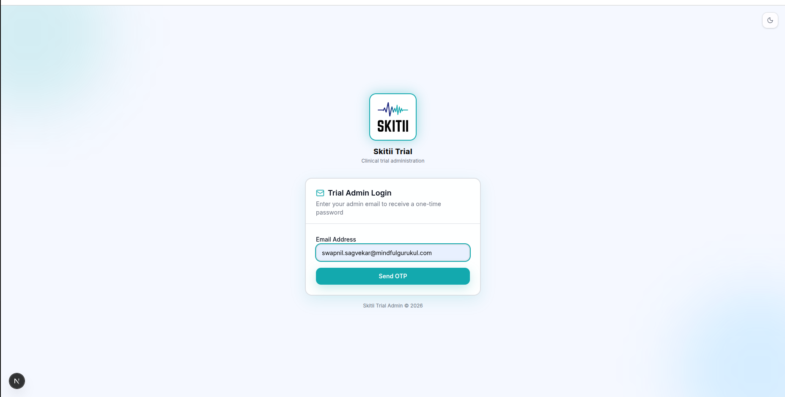

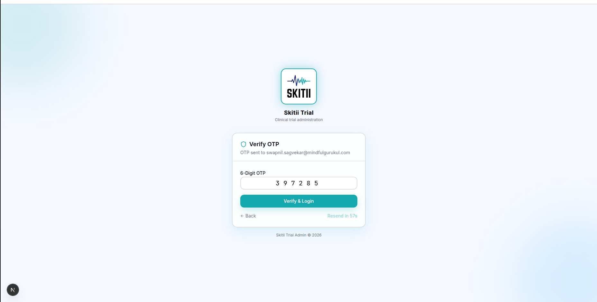

---

## 3. Layout — sidebar and scope

Every page uses the same shell.

**Left sidebar — modules**

| Section | Modules | Purpose |
|---------|---------|---------|
| — | Dashboard | Overview and shortcuts |
| **Setup** | Trials, Institutions, Configurations | Protocol and hospital mapping |
| **Operations** | Patients, Sessions | Enrolment and session review |
| **Analytics** | Session Statistics, Weekly Statistics | Completion and compliance metrics |
| — | Music | Control-group track preview |

**Institution + Trial (scope bar)**

Clinical pages include:

- **Institution** — hospital (e.g. Yenepoya)  
- **Trial** — protocol (e.g. skitii-trial-v1)

Patients, Sessions, and both Statistics pages require this scope. The selected scope is kept while moving between pages.

**Top bar**

Page title, light/dark theme toggle, and sign out. The signed-in user also appears at the bottom of the sidebar.

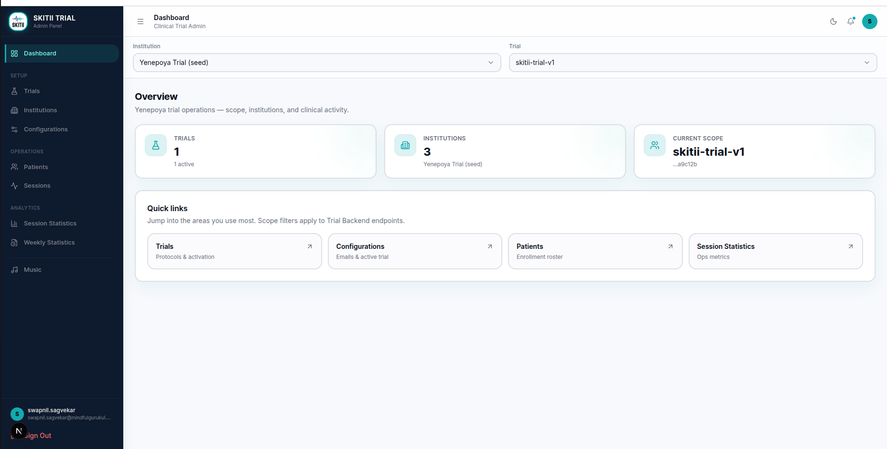

---

## 4. Dashboard

The Dashboard is the **home page** — overview only, no create/edit forms.

**Contents**

- **Trials** count — total protocols and how many are active  
- **Institutions** count — linked trial hospitals  
- **Current scope** — selected Institution + Trial  
- **Quick links** — Trials, Configurations, Patients, Session Statistics  

---

## 5. Setup — Trials

A **trial** is the study protocol. It defines:

- Study duration (weeks)  
- Therapy shifts per day and their time windows  
- Which study weeks collect weekly clinical forms, and which questionnaire steps each week includes  

Patients and sessions follow these protocol rules.

### Trial list

All protocols appear with a status badge: **active**, **inactive**, or **completed**.

Available actions:

- **Create draft** — new protocol  
- **Edit** — update an existing trial  
- **Delete** — only when no patients are enrolled  

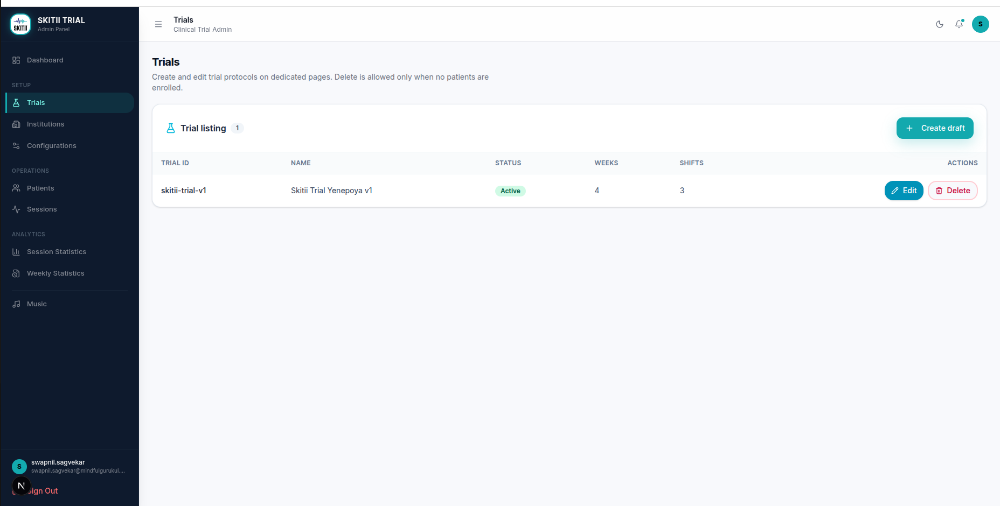

### Create / edit trial — basics and shifts

**Basics**

- Trial ID (on create), name, status  
- Duration in weeks  
- Shifts per day  
- Weekly form interval (days between form weeks)  
- Reminder days before a form window expires  
- Clinical-day start hour (when the clinical day begins)

**Shift windows** (repeatable rows)

- Shift number and label (e.g. Morning, Evening)  
- Start time and end time  
- Whether the shift crosses midnight  

These windows feed Session Statistics (Expected / Completed / Missed / Open by shift).

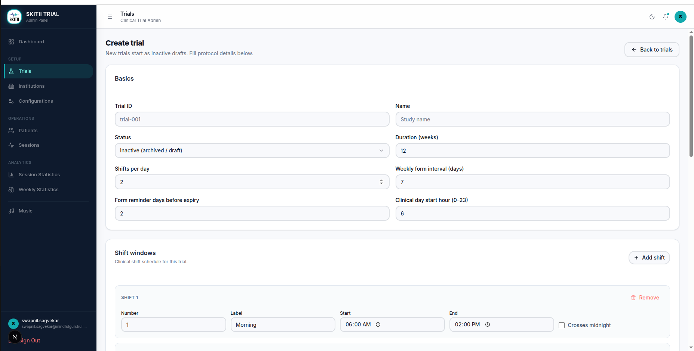

### Create / edit trial — weekly form weeks

**Weekly form definitions** list each study week (e.g. Week 0, 2, 4, 8) and the steps collected that week.

Example steps: vitals, NCCN distress, HADS, GAD-7 / PHQ-9, QLQ-C30, QLQ-HN35, treatment adherence, satisfaction survey, HRV.

The tablet and admin panel both use this list, so form content stays aligned with the protocol.

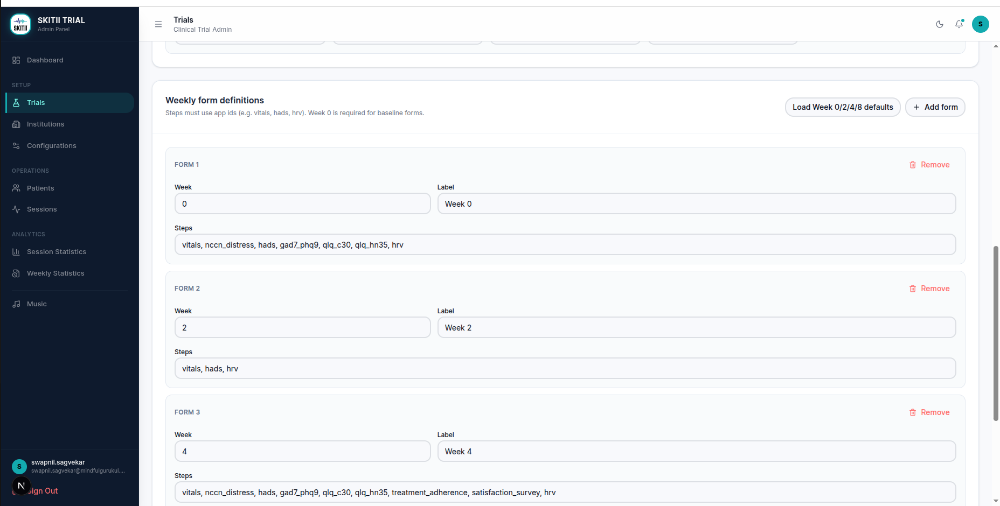

---

## 6. Setup — Institutions

**Institutions** are the hospitals in the trial. This page is a **read-only list** from the auth system.

**Columns**

- Name  
- Email  
- Active trial  
- Number of configurations (hospital↔trial links)

Hospital master records are not created or edited here (that stays in product / auth). Linking a hospital to a protocol is done under **Configurations**.

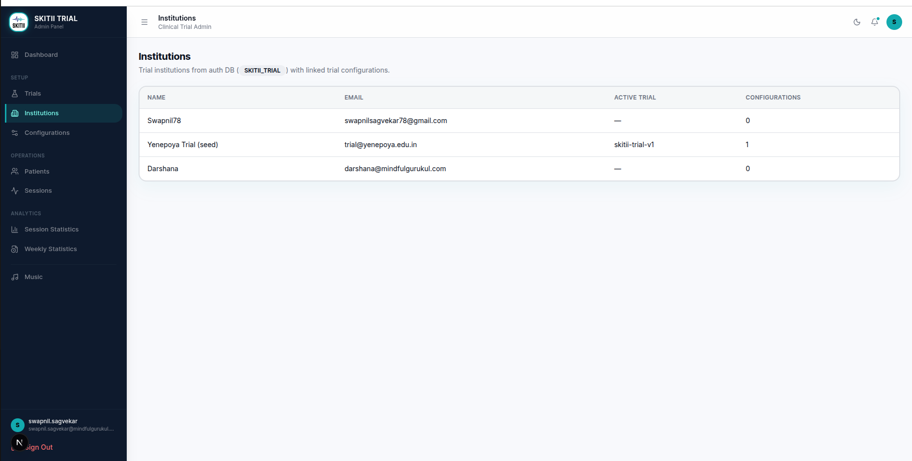

---

## 7. Setup — Configurations

Configurations connect **which hospital runs which protocol**, and expose the **weekly form PIN** for institute staff.

**Page areas**

1. **Weekly form PIN**  
   - Current 4-digit PIN for the active trial  
   - **Copy** for sharing with hospital staff (tablet weekly-form unlock)  
   - **Generate / Update PIN**  
   - Scheduled rotation also updates the PIN (e.g. Mondays early morning)

2. **Clear cache**  
   - Clears Redis caches for patients, trials, configs, and music  
   - Used after manual database fixes so apps reload fresh data

3. **Create / manage mappings**  
   - Institution + Trial, with active flag  
   - Table of existing hospital↔trial links (toggle active/inactive or remove)

Protocol definition stays under **Trials**; hospital assignment stays under **Configurations**.

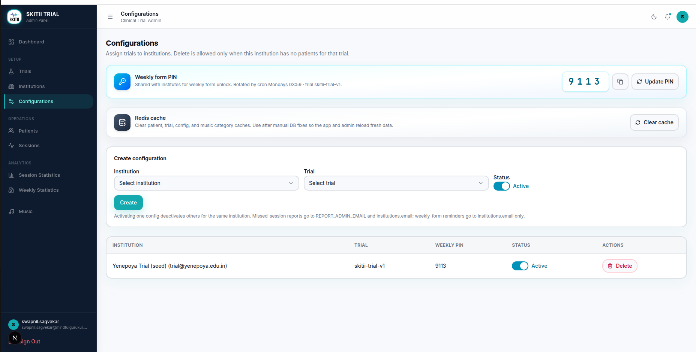

---

## 8. Operations — Patients

Patients covers enrolment and clinical review for the selected Institution + Trial.

### Patient list

Roster for the current scope.

**Capabilities**

- Search by name or registration number  
- Filter by status (active / completed / withdrawn), group (adaptive / control), Week 0 status  
- Sort columns  
- **Export CSV**  
- **View**, **Edit**, or **Add patient**  

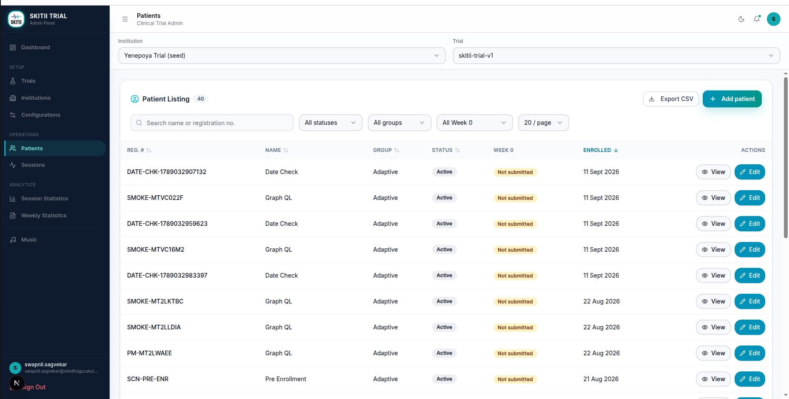

### Add patient

New enrolment is one page with three sections:

1. **Personal information** — first/last name, emergency number, language (e.g. English / Kannada / Hindi / Malayalam), age, gender, optional registration number  
2. **Clinical data** — diagnosis stage, treatment type (radio / chemo / both), cancer site, ECOG performance status  
3. **Study enrolment** — enrolment date, surgical type (pre/post-operative), group type (**adaptive** vs **control**), ANCOVA staging  

Adaptive patients follow the adaptive therapy path; control patients use the control music pool.

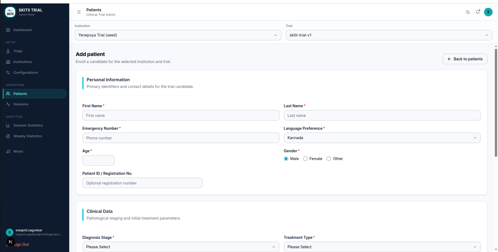

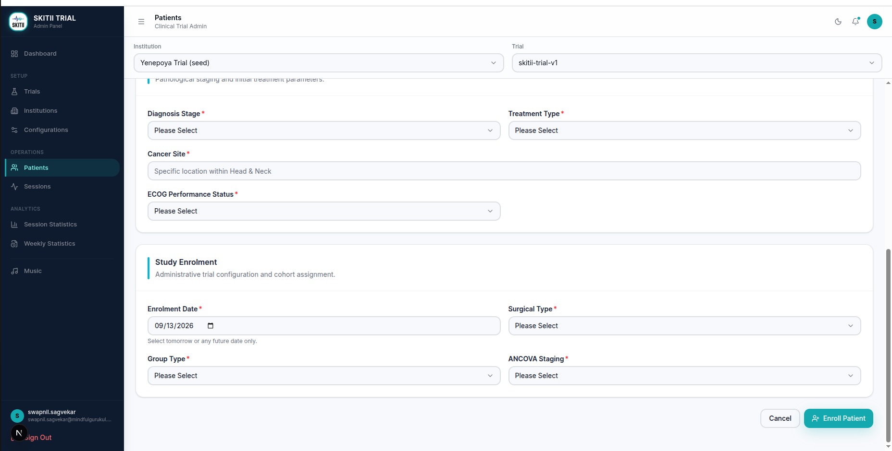

### Edit patient

Same fields as add, plus **status**:

- **Active** — on study  
- **Completed** — finished the protocol  
- **Withdrawn** — left the study  

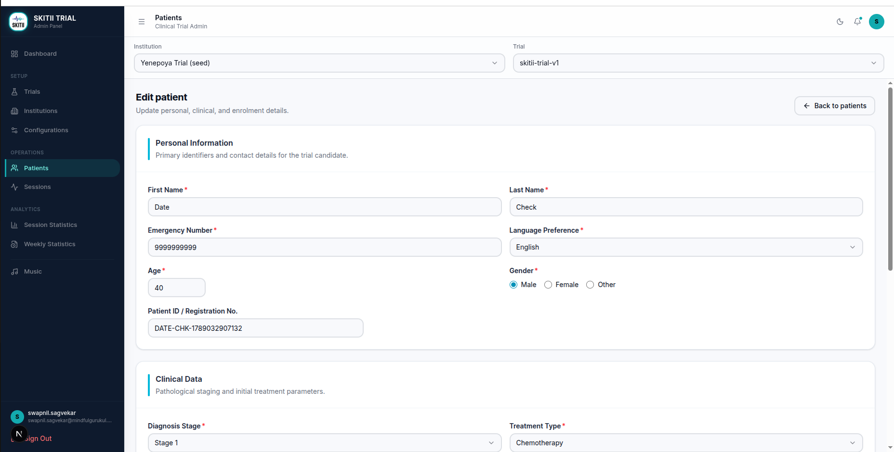

### View patient

Read-only patient overview.

**Contents**

- Summary — group, status, enrolled date, Week 0 status  
- **HRV progress** chart  
- **Session snapshot** for a clinical date + shift  
- Actions — back to list, edit profile  

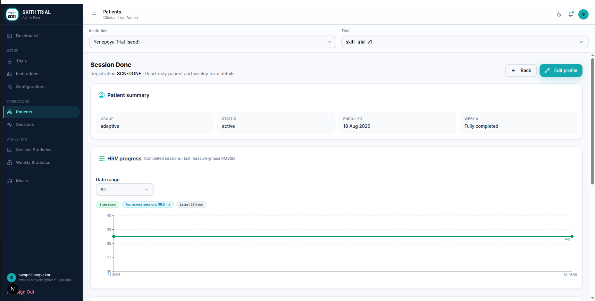

**Weekly forms schedule** lists every study week from the trial definition:

- Week label and window dates  
- Whether a form was filled  
- Status (not submitted / steps submitted / fully completed)  
- **View** opens the submitted form when available  

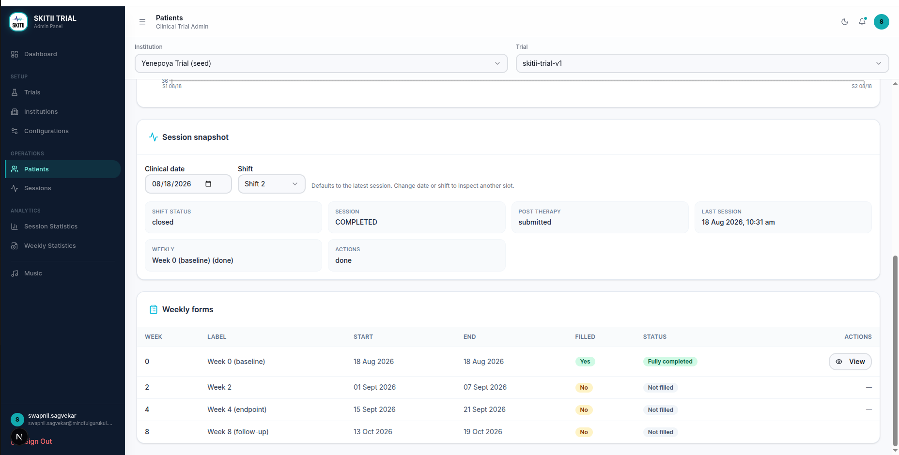

### Weekly form detail (read-only)

Opened from the schedule. Admins review tablet submissions; forms are not filled in the admin panel.

Tabs show only the steps configured for that week:

| Step | Content |
|------|---------|
| Vitals | Blood pressure, pulse, history, medication, investigations |
| HADS / GAD-7 / PHQ-9 | Anxiety and depression scores |
| NCCN distress | Distress thermometer and problem list |
| QLQ-C30 / QLQ-HN35 | Quality-of-life questionnaires |
| HRV | 5-minute resting HRV summary and heart-rate trace |

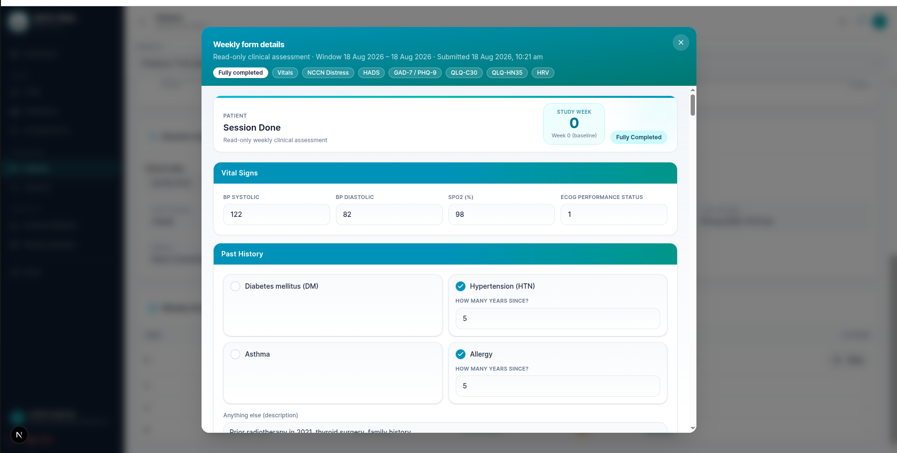

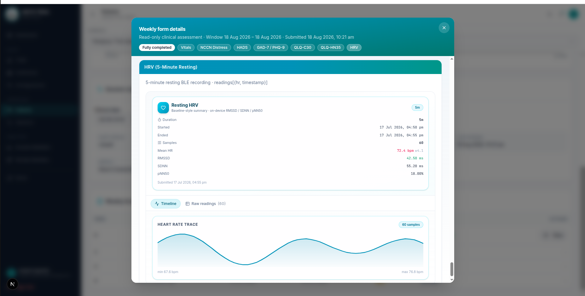

---

## 9. Operations — Sessions

Sessions is for **audit and review**. Therapy is started on the tablet; this page shows recorded sessions.

### Session list

Paginated list for the current Institution + Trial.

**Status values**

- Active — session still running  
- Completed — finished normally  
- Incomplete — stopped without a clean completion  
- Auto-terminated — ended by the system (timeout, replaced by a new session, etc.)

Search and open any row for full detail.

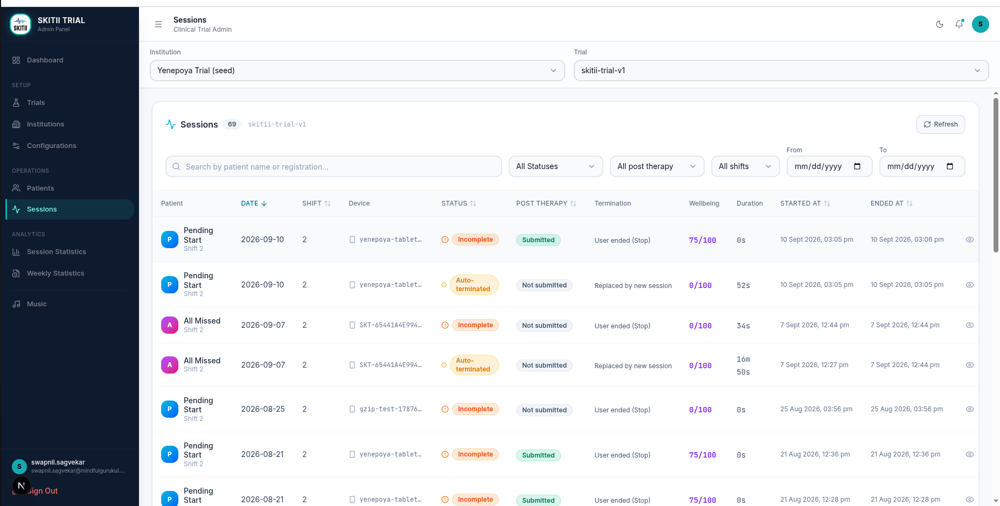

### Session detail

Detail view with tabs:

| Tab | Content | Use |
|-----|---------|-----|
| **Session Info** | Patient, device id, duration, shift, date, wellbeing, termination reason | Context and end reason |
| **Pre Therapy** | Form answers before therapy | Visit baseline |
| **Post Therapy** | Form answers after the session | Completion signal for statistics |
| **Session Readings** | Heart-rate / phase chart during the session | Physiological trace |

Session start is not available in admin — only on the tablet.

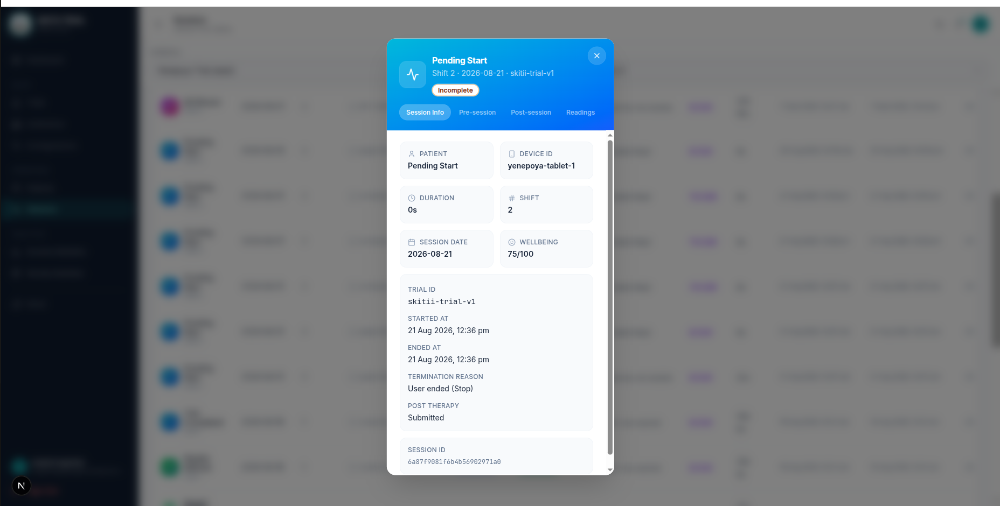

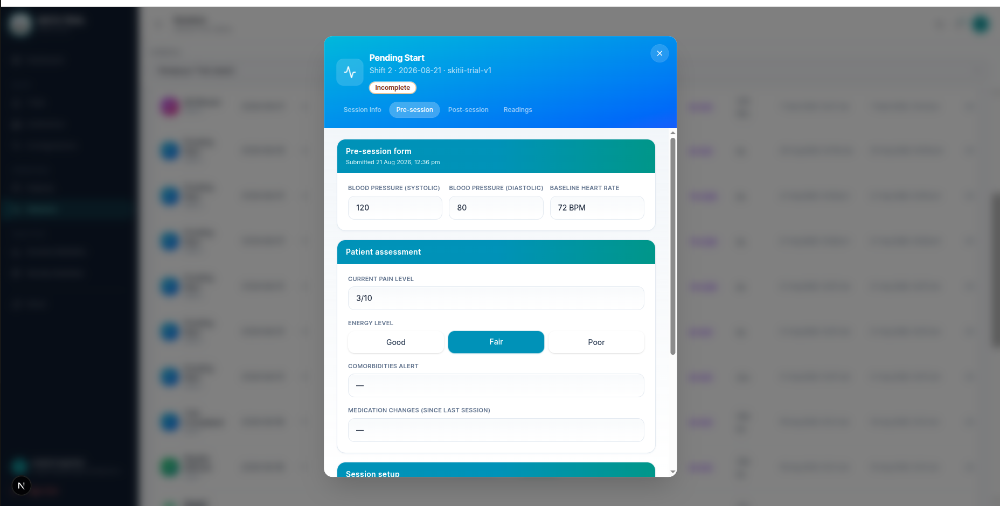

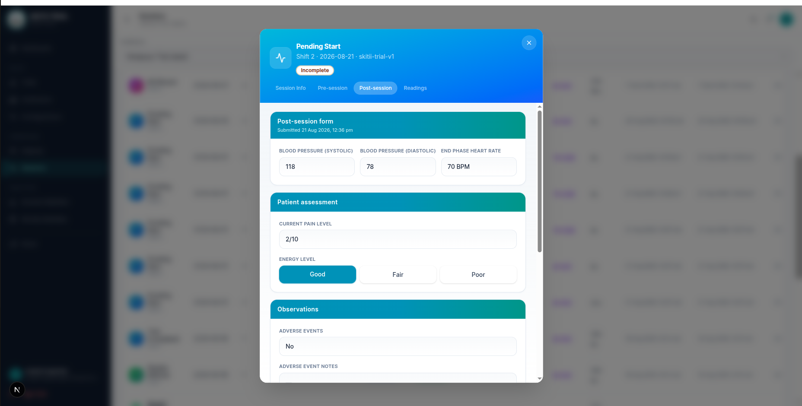

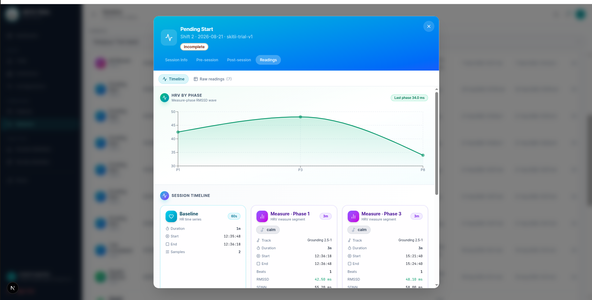

---

## 10. Analytics — Session Statistics

Session Statistics shows whether **therapy shifts are completing as planned** for the selected Institution + Trial.

Date range options: Today, last 3 / 7 / 14 days, or custom. The resolved clinical period is shown under the filter.

**Page flow**

1. Date range  
2. KPI cards  
3. Charts (overall status + by shift)  
4. Breakdown table  
5. Click a KPI or chart segment for the patient / slot list  
6. Optional **Export CSV**  

| KPI | Meaning |
|-----|---------|
| Registered patients | Patients created in the selected period |
| Expected sessions | Patient × shift slots due in range |
| Completed | Slot finished with post-therapy (rate shown) |
| Missed | Shift window closed with no post-therapy |
| Open | Shift window still active — not counted as missed yet |

Missed applies only **after** the shift window closes. For each shift: Completed + Missed + Open = Expected.

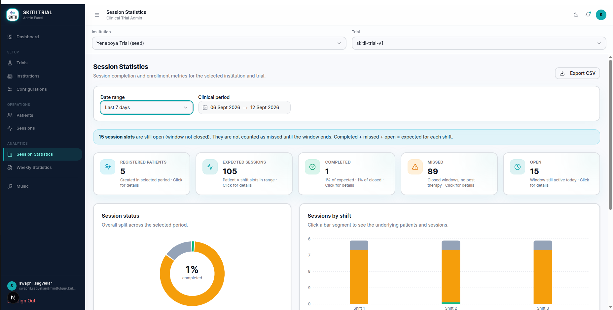

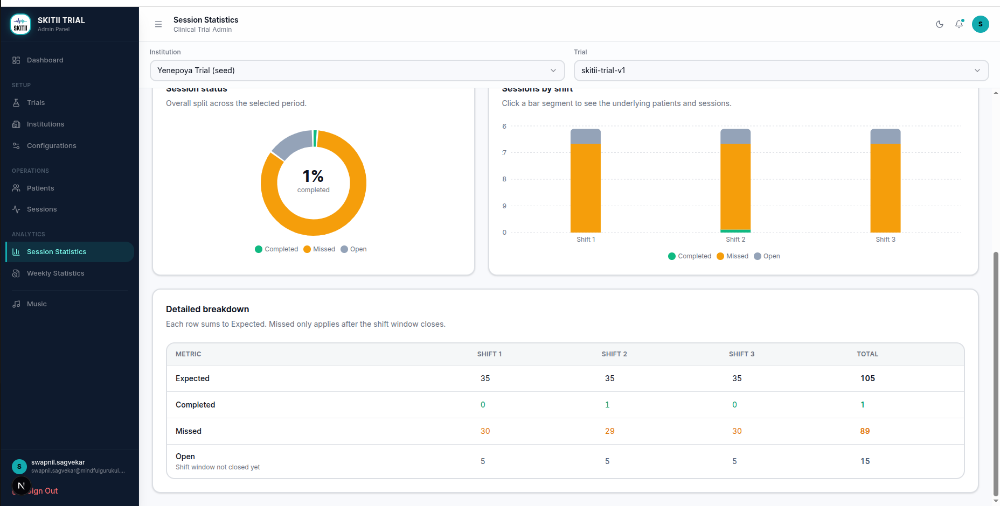

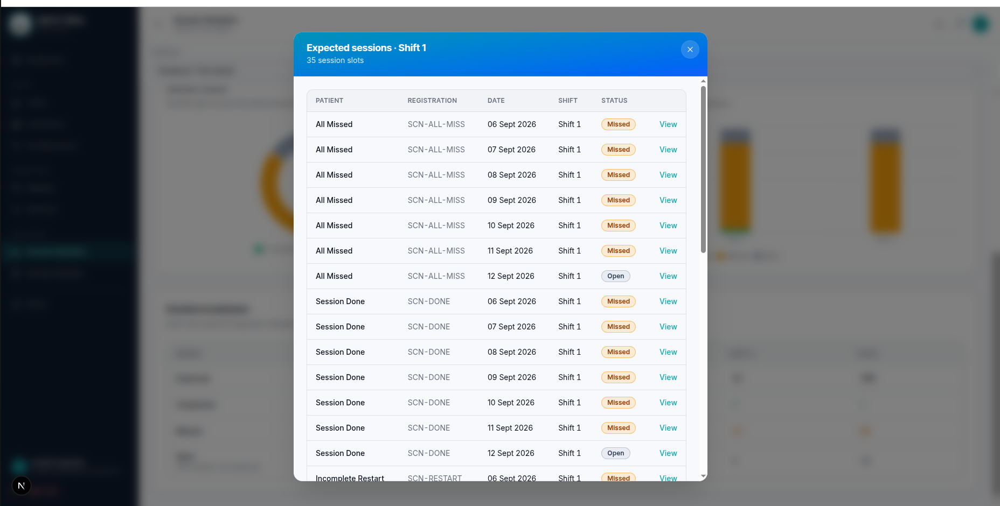

---

## 11. Analytics — Weekly Statistics

Weekly Statistics shows whether **weekly clinical forms are completed on time**.

Same pattern as Session Statistics (date range → KPIs → charts → table → drill-down), with the axis as **study week** (Week 0, 2, 4, … from the trial definition) instead of therapy shift.

| | Session Statistics | Weekly Statistics |
|--|--------------------|-------------------|
| Focus | Therapy shifts | Weekly clinical forms |
| Axis | Shifts 1 / 2 / 3 | Study weeks |
| Unit | Session slots | Weekly form windows |
| Missed | No post-therapy after shift closed | Form window closed, form not fully completed |

Together, the two screens cover operations completion (sessions) and clinical-review completion (weekly forms).

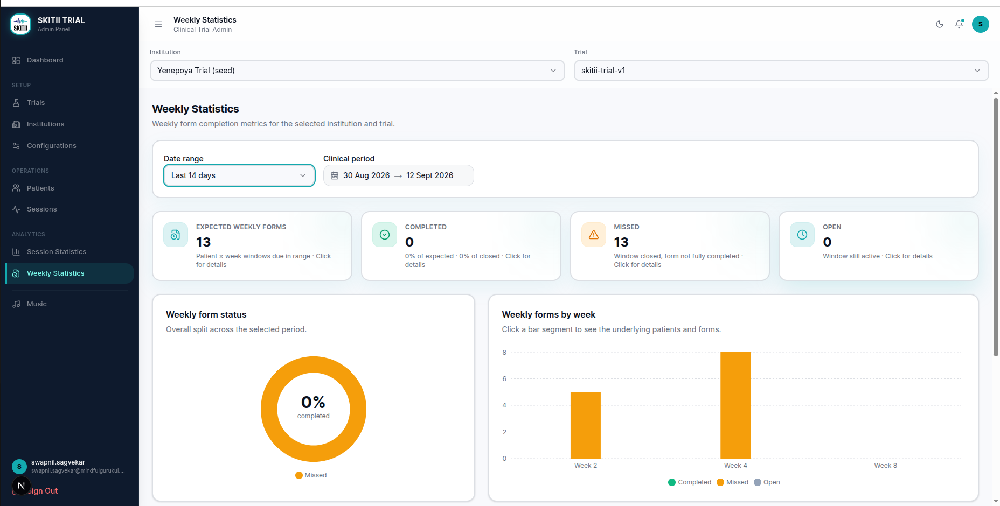

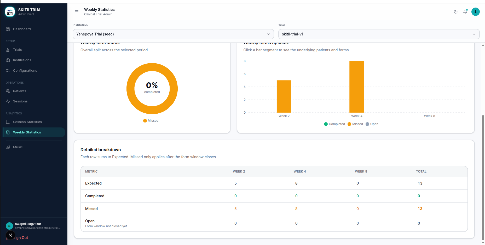

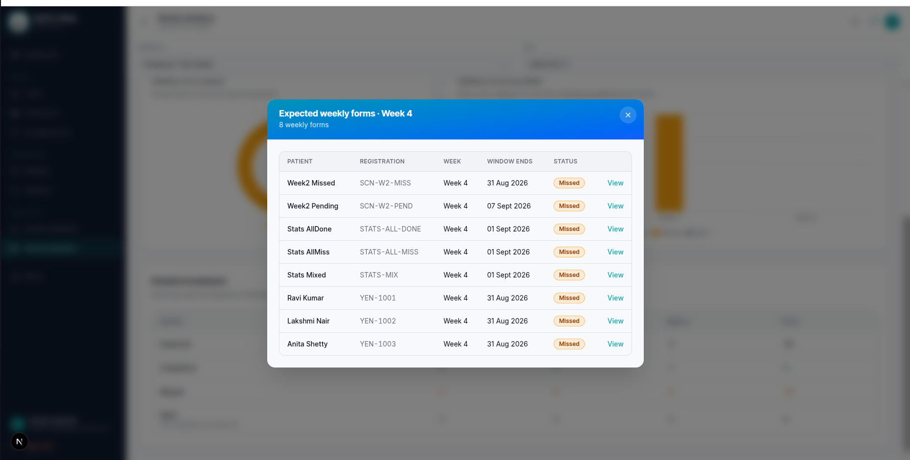

---

## 12. Music

The Music page previews the **control-group** catalogue — tracks available to control patients during sessions.

**Capabilities**

- Browse list (title, category, duration)  
- Search by name  
- Filter by category (e.g. Calming, Meditation, Nature Sounds)  
- In-page player: play / pause / seek / previous / next  

**Not included on this page**

- Upload new tracks  
- Catalogue CMS / library editing  

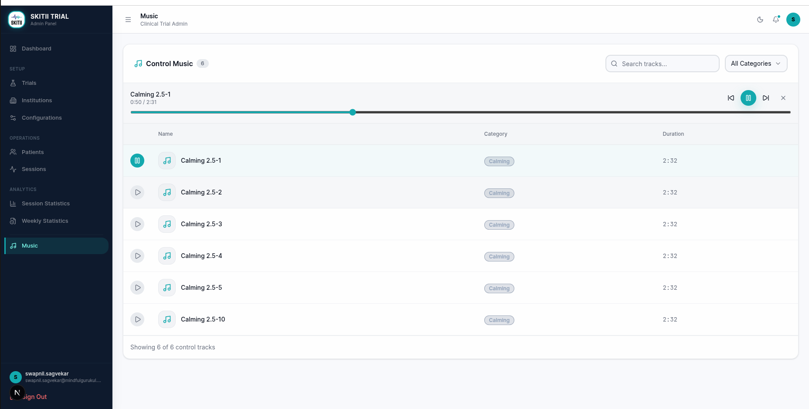

---

## 13. End-to-end flow

How the modules connect in practice:

1. **Sign in** with email OTP  
2. Select **Institution** + **Trial**  
3. **Patients** — enrol and review weekly forms  
4. **Sessions** — review therapy visits and readings  
5. **Session Statistics** and **Weekly Statistics** — completion metrics  
6. **Configurations** — weekly PIN and hospital↔trial mapping when needed  

**Setup** (Trials, Institutions, Configurations) establishes the study. **Operations** and **Analytics** support ongoing trial monitoring.

---

## 14. Scope boundaries

| Outside Trial Admin | Handled by |
|---------------------|------------|
| Start or stop a live therapy session | Tablet app |
| Create / edit hospital master records | Product / auth |
| Upload or manage the music library | Separate catalogue tooling |
| Product-wide users, roles, and permissions | Product Admin (RBAC) |
| Fill weekly forms as the clinician | Tablet (admin reviews only) |

---

## Quick module map

| Section | Module | Purpose |
|---------|--------|---------|
| — | Dashboard | Counts and shortcuts |
| Setup | Trials | Protocol (duration, shifts, weekly forms) |
| Setup | Institutions | Read-only hospital list |
| Setup | Configurations | Hospital↔trial map, weekly PIN, cache |
| Operations | Patients | Enrol, edit, view, weekly form review |
| Operations | Sessions | Review therapy sessions and readings |
| Analytics | Session Statistics | Shift completion KPIs and drill-down |
| Analytics | Weekly Statistics | Weekly form completion KPIs and drill-down |
| — | Music | Control music preview |
